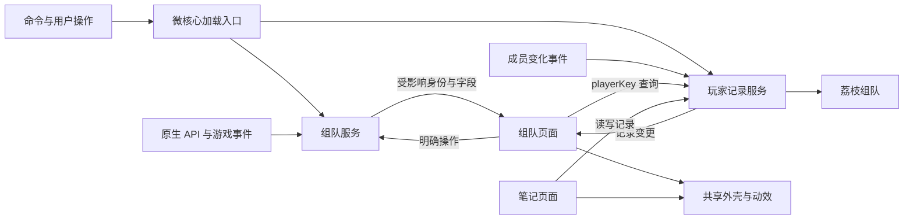

# 荔枝组队 · Lychee LFG 程序架构

更新日期：2026-10-18。

状态：2026-10-18。原生 Lua 界面采用内置 LycheeUI 1.1.7（修订 9），仍以四个产品包发布。本轮修正开关反馈、页面订阅与重复刷新，加入目录成员集合、成员对象复用和按需构建，并清理无调用的旧提示链及闲置字段。已构建、安装并在主客户端重载，离线回归、控制器与性能检查结果见 [Product.md 第 7 节](Product.md#7-用户可见的验收结果)及 [perfermance.md 第 12 节](perfermance.md#12-当前内存测试与验证状态)。此前申请动线、Notes 旧记录解析、队友专精、终态清理、原生入口路由与品牌提醒继续保留；描述搜索、完整真实邀请权限／taint 和引擎资源归因仍按原边界处理。

产品范围见 [Product.md](Product.md)，视觉与动画轨迹见 [Desgin.md](Desgin.md)，资源额度与测量方法见 [perfermance.md](perfermance.md)。

## 1. 架构决定

使用 WoW 原生 Lua UI，建立自己的启动入口、业务状态和界面。产品业务采用 `LycheeGroup` 命名体系，独立通用库采用 `LycheeUI` 命名。

LycheeGroup 的四个 AddOn 分别为微核心、组队业务、玩家记录、统一界面；[LycheeUI](../LycheeUI) 在独立源码目录维护，发布时复制进主包 `Libs/LycheeUI`，由主包 TOC 引用 `embeds.xml`，游戏插件列表不新增独立库。共享库不保存业务状态，不声明 SavedVariables 或登录事件；Context 拥有主题、控件、原生控件租借、动效和菜单实例，使用者按自身界面生命周期调用。模块可以在包内按职责分文件，不为每个页面、语言、动效或工具另拆子插件。

Group 包内置 LibSpecialization minor 28 和 LibStub，加载顺序为 LibStub → LibSpecialization → Group 与 Roster；已有同版或更新版时复用共享实例。第三方源码保持原样及原名称，来源与许可证见 [Libs/README.md](addon/LycheeGroup_Group/Libs/README.md)。

主窗口的通用拖动由 `LycheeUI.C.Draggable` 管理，应用仅登记外壳、品牌及具有 hover 的被动背景区域；子级交互控件自行接收输入。拖动结束将当前锚点交给同一 Context 的 Motion，开关动画沿该锚点运行，位置只保留于当前会话。

主包只保存启动所需的小配置、明确入口和加载关系。组队业务、玩家记录和界面使用真实 AddOn 按需加载；不把整套代码放在主包后只延迟创建窗口。后台记录提醒无需加载界面，单独打开笔记无需加载组队业务。

每项业务只有一个状态所有者。游戏事件推动相关变化，可见页面订阅所需字段，后台功能只保留真实业务需要的数据和事件。组队与笔记通过玩家身份直接联系，不互相 hook 控件，不将理由复制到各条队伍记录。

模块直接调用具名接口，不预建通用插件平台、全局广播总线、万能任务系统或多层兼容框架。加载、激活与清理使用明确函数与状态。

暴雪 API 的调用条件、频率和事件通过荔枝 Dev 的固定版本源码核实。本地读取与服务器请求分开处理，请求在明确入口合并并尊重原生限流状态，不通过常驻轮询或重试风暴维持同步。

## 2. 四个业务包与共享库

四个业务包与独立共享库的运行职责如下；本轮离线回归已覆盖共享库加载与产品适配。

| 包 | 职责与数据 | 加载条件 | 依赖 |
| --- | --- | --- | --- |
| `LycheeGroup` | 微核心：命名空间、小设置、入口、固定加载表、冷启动恢复、业务唤醒及独立轻量浮窗 | 登录 | 内置 LycheeUI 定义；浮窗按需创建 Context 和控件 |
| `LycheeGroup_Group` | 原生活动目录、搜索、结果、申请、招募、申请者、原生申请音、大秘境历史队友；不含业务页面 | 打开组队页面，或存在真实组队业务需要跟踪（含大秘境活动进行中） | 主包 |
| `LycheeGroup_Notes` | 玩家记录、身份匹配、队伍提醒、记录变更与按需专精查询；不含界面 | 显式记录／查看／导入，或笔记启用且已有名单需要后台提醒 | 主包 |
| `LycheeGroup_UI` | 产品外壳与页面、游戏数据和原生输入适配、导入导出编解码；Theme／Motion／Components 为共享库薄适配 | 首次打开自有界面 | `LycheeGroup` |
| 内置 `LycheeUI` | 可复用普通／原生注册控件、主题、动效、菜单与共享素材；无业务存档或登录工作 | 函数定义随主包；Context、控件、菜单与驱动按实际使用创建 | 不产生独立 AddOn |

主包 TOC 不列入子包实现文件，也不将子包作为强制依赖。三个产品子包声明 `LoadOnDemand: 1`。`LycheeGroup_UI` 的 TOC 声明 `Dependencies: LycheeGroup`，不强制依赖两套业务包，由路由入口在进入目标页面前加载其业务：组队页需要 Group，笔记页需要 Notes，通用设置不强行启动两者。

统一界面包首次加载时，其页面函数定义会一起进入内存；这部分首开和保留成本如实计算。各页面的 Frame、展示数据、菜单、弹窗和派生表仍首次使用才创建。四个业务包保留后台与界面的真实隔离，同时避免逐页拆包带来的安装和维护负担。

```text
addon/
  LycheeGroup/
    Core、Entrypoints、Floating、最小 Locale、主配置
  LycheeGroup_Group/
    Group、Game、Catalog、Search、Results、Applications、Listing、Applicants、Alerts、History、Locale
  LycheeGroup_Notes/
    Records、RosterReminder、PlayerInfo、Locale
  LycheeGroup_UI/
    Theme、Motion、Host、Components、Tooltip、Native、Preview、Find、Create、Notes、Settings、Transfer、Media、Locale
```

品牌原始文件保留在 [Media](Media/lychee-logo.png)；共享素材源位于 [LycheeUI/Media](../LycheeUI/Media)，运行时位于主包 `Libs/LycheeUI/Media`，由库主题提供路径，产品中的旧素材副本暂未清理。四个产品包的 TOC `IconTexture` 统一引用主包的 `Media/addon-logo.tga`，与界面和动效使用的共享品牌素材分开维护；素材设计见 [Desgin.md](Desgin.md#1-品牌与语言)。共享库源码位于 `D:/Code/wow/addons/LycheeUI`，与本产品独立。磁盘素材引用不需要加载业务 UI。

运行 `tools/Sync-LycheeUI.ps1` 从独立源码同步内置库，运行 `tools/Build-Addon.ps1` 生成只含四个产品目录的安装包。产品内置副本不包含库 TOC、测试或说明文档，不手工维护第二份源码。其他插件的接入方式和公共接口由共享库 [README](../LycheeUI/README.md) 与 [API.md](../LycheeUI/API.md) 维护。

## 3. 加载、激活与退出

包加载状态和业务活动状态分开：包可以已经加载但没有活动业务。WoW 加载 AddOn 后不能通过关闭窗口卸载它，Lua 定义、存档和已创建的原生对象仍须按真实保留量计算。

加载器只维护固定包表与 `unloaded → loading → ready / failed`。加载成功后调用明确的初始化／激活入口，再处理当前用户意图；不依赖已经发生的 `PLAYER_LOGIN` 被重新触发。重复打开不积累大型待办队列，加载失败说明原因，不后台无限重试。

冷启动只把进行中的申请、邀请或待处理状态视为 LFG 业务；原生应用列表中的已拒绝、已接受和已取消条目不会单独唤醒 Group。

原生小地图组队眼睛的路由由 Entrypoints 持有。账号设置 `nativeLFGEntry` 决定是否把预组队相关左键交给 `A:Open`，依据当前招募或申请状态选择创建／寻队页；原生右键、战场优先级和其他队列仍委托安装时的原点击回调。路由只在按钮已加载时安装一次；未加载时仅等对应 ADDON_LOADED，绑定后退订，关闭设置直接走原回调，不预加载业务界面。

主包 TOC 随自身加载内置库函数定义；WoW 的 `LoadAddOn` 以 AddOn 为单位，不提供本项目可用的任意包内 Lua 文件加载接口。浮窗启用时才创建其 Context 和控件，此路径不加载 LycheeGroup_UI。关闭浮窗不能卸载已经加载的库定义；库成本归主包计入当前四包总量。此前独立库五包测量保留为历史口径，不直接与新布局的主包数字比较。

首次打开前按目标页面加载依赖。搜索、申请和邀请等依赖硬件事件或受保护时序的动作保持合法调用链，不能统一丢进 timer。战斗中没有整窗门禁，也不自动隐藏窗口；具体限制在平台接入点核实，不排队重放过期动作。Esc 通过 `UISpecialFrames` 的关闭请求进入 Host，依次关闭当前弹窗、固定提示、菜单、活动选择器、筛选和主窗，保留清理与退场。首次在战斗中构建查找页时，只把键盘传播设置延后到一次脱战事件；鼠标操作和已初始化的快捷键不受该初始化步骤影响。行内提示触发区只接收移动与进出事件，将行反馈交回所属行，不调用受保护的鼠标点击／移动传播设置。

| 状态 | 需要的工作 | 不应连带加载或继续的工作 |
| --- | --- | --- |
| 登录，未使用且无活动业务／名单 | 小配置、命令、必要唤醒入口；随主包加载库定义，浮窗启用时创建可复用控件池 | Group、Notes、LycheeGroup_UI、活动目录和业务页面 |
| 笔记启用且已有记录 | Notes 数据与入队提醒；登录核对当前队伍 | UI、Group、完整名单排序、导出文本 |
| 只打开荔枝笔记 | Notes、LycheeGroup_UI，创建笔记页面 | Group、组队页控件 |
| 打开寻求组队／创建组队 | Group、LycheeGroup_UI，创建目标页面；已有记录且启用时查询 Notes | 无理由创建笔记页／导出弹窗 |
| 关窗但申请／招募仍活动 | 对应业务状态、结果监听与必要通知 | 行刷新、排序、提示、输入与无用搜索快照 |
| 关窗且组队业务结束 | 已加载定义、小设置、按需保留的笔记提醒 | 周期刷新、空转 ticker、历史结果链与失效回调 |

主配置保存 `notesEnabled`、`notesHasRecords` 等小摘要供冷启动选择，不复制名单。Notes 写入、删除和导入时同步摘要；记录仍以 Notes 的唯一存档为准，初始化时核对摘要。停用自动提醒后仍可显式打开名单管理。

`ADDON_LOADED` 仅处理主包自身并随即退订，`PLAYER_LOGIN` 只执行一次。冷启动对原生仍存在的申请／招募和进行中的大秘境做必要恢复；空闲时主包只保留申请状态、招募变化和秘境开始三个唤醒事件。Group 初始化完成后主包撤销这些监听，由 Group.Game 接管；搜索与活动目录监听随 `Attach/Detach`，申请者监听随真实招募启停，不让两套处理器推进同一状态。

## 4. 状态所有权与数据流



| 所有者 | 权威状态 | 消费方式 |
| --- | --- | --- |
| Group.Search | 当前条件、搜索请求和代次 | 发起搜索，只提交当前相关结果 |
| Group.Results | 当前完整合法结果、必要元数据与搜索代次 | 按身份读取，筛选／排序产生 ID 顺序，不深拷贝全库 |
| Group.Applications | 所有分类已提交申请与邀请状态、原生到期时刻、终态展示清理和单个自动接受中的邀请 | 全局五项额度；独立于页面寿命，实际结果驱动状态 |
| Group.Listing / Applicants | 当前招募与当前申请者、终态展示清理 | 更新具体记录，招募结束清理所属数据 |
| Group.History | 当前角色大秘境历史 run 与进行中活动的成员基线 | 活动事件驱动去重记录；活动结束退订队伍监听，不周期扫描 |
| Group.Alerts | 当前批次合并任务及一个原生声音句柄 | Applicants 的新增申请触发，播放完成事件或招募结束清理 |
| Group.Roster | 当前成员快照、按 GUID 保存的库同步专精／检视结果与单个检视请求 | LibSpecialization 回调与游戏事件使快照失效；创建页需要且缺数据时才检视 |
| Notes.Records | `playerKey → record` 持久记录 | 唯一读写入口，命中后按需读取理由 |
| Notes.RosterReminder | 当前队伍命中集合、收邀事件与一次安全出邀 hook | 成员差异及邀请触发本地提醒；离队清集合，停用退订，hook 静默 |
| Notes.PlayerInfo | 当前有效专精查询和必要短期缓存 | 供实际记录操作使用，结束后释放请求 |
| 各页面 | 选择、滚动、草稿、可见行身份 | 订阅所需变更，不另建业务状态机 |

[Preview.lua](addon/LycheeGroup_UI/Preview.lua) 提供独立内存 provider，`UI:GetGroup()` 在显式模拟开启时选择它，否则返回真实 `A.Group`。页面与提示经此入口读取组队数据；真实 Group 服务、原生登记输入对象和 SavedVariables 不被替换或写入。模拟命令与退出行为见 [Product.md 第 5.2 节](Product.md#52-显式模拟入口)，分配及释放边界见 [perfermance.md](perfermance.md)。

`PlayerKey` 统一名字和服务器的规范化与键构造，`UnitIdentity` 在原生单位读取边界过滤未知、非玩家和受限身份；两者不持有全服玩家缓存。远程 LFG 的 `RemotePlayerKey` 只接受原生明确的完整身份，不把裸名猜成本服玩家。记录写入确认单位仍对应该身份，异步专精完成确认 GUID。Group 的专精解析优先已知 specID，否则只在已知职业内精确匹配原生专精名；未知保留未知，不为图标编造字段。当前队伍以 `UnitIsUnit(unit,"player")` 识别自身的 `raidN` 等别名，自身使用当前专精接口与平均装等。

队友专精由 Roster 优先读取 LibSpecialization 回调缓存，其次读取原生检视结果。库回调的名字可能省略本服，先与当前真实成员身份匹配，再按 GUID 保存；不保存天赋字符串，不匹配队外玩家。库没有历史回放，公开 `RequestGroupSpecialization()` 已为空函数，因此不通过它重复发消息。Group 加载后接收库事件，创建页隐藏时仍可保存新广播；不会停掉其他插件共用的库监听。

创建页首次消费缺失专精时给库回调一次等待机会，之后通过 `CanInspect` 选择成员、串行 `NotifyInspect`，只在匹配 GUID 的 `INSPECT_READY` 后提交结果并通知界面。专精变化清除该成员旧值；新成员、重新上线及脱战事件重新推进尚缺的信息。原生检视窗口打开时让出，关闭事件继续；不调用 `ClearInspectPlayer`。离开最后一个创建页消费者取消本项目请求／计时器及检视相关事件。所有等待与节流参数只在 [perfermance.md](perfermance.md#6-招募申请者与通讯) 维护。

## 5. 事件驱动的实际边界

事件直接路由到所有者，依据参数定位受影响记录。`Group:Notify` 负责变化通知，`Group:Publish` 只负责发布招募，二者不共用名称。页面不可见时不生成展示对象；可覆盖状态按同一所有者／同一用途合并，不丢弃用户动作。

| 触发 | 所有者与处理 | 结束条件 |
| --- | --- | --- |
| 大秘境开始／完成、活动期间队伍变化 | Group.History 建立当前 run 与成员基线，去重记录队友快照 | run 完成写入历史；活动结束退订队伍监听，重登由冷启动恢复 |

| 触发 | 所有者与处理 | 结束条件 |
| --- | --- | --- |
| 用户搜索、结果到达／变化 | Search / Results 更新本次结果；成员资格或排序键变化才重算 | 搜索替换、视图结束且无其他消费者 |
| 申请状态或邀请变化 | Applications 推进申请并通知必要消费者 | 最后一个活动申请结束 |
| 招募或申请者变化 | Listing / Applicants 更新相关记录 | 招募结束且无待确认操作 |
| 队伍成员变化 | Notes 比较成员与已提醒集合 | 离队清基线，停用退订并取消检查 |
| 笔记记录变化 | 发布受影响 `playerKey` 与版本，刷新命中行 | 本次局部更新完成 |
| 专精结果 | 只完成当前目标、当前请求 | 完成、失效、取消或超时，不循环检视全队 |
| 界面显示／隐藏 | 建立／撤销页面订阅，清绑定，完成有限退出动画 | 退出终态移除驱动 |
| 语言或显示配置变化 | 相关文案／布局失效 | 受影响展示更新完成 |

此表是责任合同，具体原生事件名、返回值与权限须按目标客户端固定源码核实。只有实际等待无法用事件完成时才使用有截止时间的单次任务，不以通用轮询器代替事件接入。

业务更新、显示更新和动画更新分离。窗口可见不意味着每帧读取 API；动画活跃不意味着每帧重算筛选或重排子控件。空闲没有周期性 Lua 工作，后台需求必须能指向具体申请、招募或笔记提醒。

Applicants 逐条接收原生事件并立即更新状态，将同一轮事件的页面通知合并到单个可取消任务；用户动作、显式刷新及清理仍立即通知并取消旧任务。Find 修改筛选后由 provider 的结果通知刷新一次。Create 重入时复用现有 Group／Notes 订阅，离开统一撤销，避免隐藏页面仍被旧回调更新。

## 6. 搜索与组队链路

`Group.Catalog` 已接入 `GetAvailableCategories`、`GetLfgCategoryInfo`、`GetAvailableActivityGroups`、`GetAvailableActivities(categoryID, groupID, filters)` 与 `GetActivityInfoTable`。活动组对应活动，具体原生 ID 携带难度、钥石／评级 PvP 等属性；目录和表单不统一伪造难度。选择保留 categoryKey、groupKey、activityID，同名副本的季赛与原资料片上下文不合并。资料片优先从冒险指南映射；地下堡只使用目标 build 的 Map DB2 ExpansionID 派生小映射，名称取客户端，未知映射仍列在全部活动，不凭当前资料片反猜。

Catalog 按分类保存活动 ID 成员集合，与该分类目录共同失效，匹配结果时不重复遍历完整活动数组。Applications 重新读取原生快照时复用自己的结果对象；成员详情仍按更新读取，同一位置且完整身份相同的成员复用表并清除旧字段，换人、重排或身份未知时保留旧引用的身份。详情数组清除多余尾项，不以少读原生数据换取分配下降。

源码依据：`wow-ui-source` retail 固定提交 `18c6d677b605b312f3d813d498404631fb941977`，`LFGList.lua` 的 `LFGListEntryCreation_SetupGroupDropdown`、`LFGListEntryCreation_SetupActivityDropdown` 和 `LFGListEntryCreation_Select`，以及 `Blizzard_APIDocumentationGenerated/LFGListInfoDocumentation.lua` 的活动记录定义。

2026-10-16 在 build 12.1.5.70391 上只读核对了原生目录，结果见 [目录观察](.lycheedev/premade-catalog-result.json) 与 [指定副本补充观察](.lycheedev/premade-followup-result.json)。千丝之城返回普通／英雄／史诗三个活动；赛季诸王之眠只有英雄／史诗／史诗钥石。团本不能直接沿用地下城的 `CurrentSeason` 过滤：该组合返回零组，而 `Recommended | PvE` 返回七组；`isCurrentRaidActivity` 在部分旧团本也为真，不能单独作为赛季归属。观察范围仅为当前角色和客户端可用目录，不代表所有角色或后续版本。

当前目录进一步只读验证：`GetAvailableActivities(2,nil,68)` 返回当季地图真实支持的普通、英雄、史诗与钥石变体；保留完整返回集，不在内部再筛成仅钥石。季赛地下城搜索使用 PvE 条件及明确原生活动 ID，唯一难度匹配才传单一 ID，不能展示普通却仍以仅钥石条件搜索；赛季团本使用 PvE 全量活动与冒险指南当前赛季团本集合的交集，不能照搬地下城 CurrentSeason 条件，也不能用 Recommended 推荐池代替赛季。目录数据观察不等于真实搜索流程验收。

2026-10-17 在同一 build 的[当前目录观察](.lycheedev/raid-native-season-state-01.json)中，冒险指南动态末项为“本赛季”，团本列表包含三座赛季副本与世界首领集合；LFG 推荐池还包含四座其他赛季团本。Catalog 单独保存末项的团本 journal ID 集合，与 `mapID > 0` 的原生活动交叉匹配，排除世界首领并保留每座副本的各难度。普通资料片映射不被末项重复条目覆盖；普通团本读取 PvE 全量目录，当前资料片同样可浏览。末项识别已在该 build 实测，并非已查到公开的专用赛季 API。目录失效时一并清理资料片与赛季缓存。

申请倒计时已接入：原生 `LFGListSearchEntry_Update`（同文件 3271、3361 附近）读取 `GetApplicationInfo` 第四返回值 `appDuration`，`Applications` 以 `GetTime() + appDuration` 持有到期时刻，UI 只在可见等待申请期间更新显示。网页五分钟只是演示值，正式版不固定五分钟；UI 不将缺少期限解释为过期。Apply 只采纳原生列表和事件，不人为补出 pending 申请；Cancel 读回原生状态并通知界面，原生缺席或已结束条目不再占名额。UI 与浮窗复用 Applications 的有效性判断，取消按钮复用 CanCancel。真实申请提交与取消权限仍保留游戏内验证边界。

Applications 与 Applicants 在收到原生已结束状态后设置一次展示清理期限；各自只安排最近期限，到期批量移除记录并通知页面。重复终态不重新计时，原生缺席可以提前清理；仅保留当前原生 ID 的移除标记防止迟到快照重新生成旧行，下一轮 applied 或原生列表移除时清除标记。邀请和待确认状态仍由原生事件推进；具体显示期限与任务约束见产品、性能文档。

邀请保留原生 `LFGListInviteDialog`，置顶申请只订阅邀请状态，不创建第二套回应按钮。共享 `autoJoin` 默认关闭；开启或收到状态事件后，`TryAutoJoin` 只选一条有效、未处理中且未尝试的申请邀请，持有单个 accepting ID，由事件确认结果，关窗不停止。上述固定源码 `LFGListInviteDialog_CheckPending` 对 invited 且无 pendingStatus 的记录显示弹窗并使用原生准备音。源码见 [固定版本源码](https://github.com/Gethe/wow-ui-source/tree/18c6d677b605b312f3d813d498404631fb941977/Interface/AddOns)中的 `LFGList.lua` 3684–3810 行。跨轮状态锁仅在新的 applied／pending applied 边沿解除，包含原生入口提交；重复同步不会重置已接受标志。实际接受权限与时序仍待实机验收。

1. 页面将明确的活动、条件和用户动作交给 Search，在接入点执行原生操作。
2. 结果事件更新 Results，保留当前完整合法集合，替换时释放旧搜索数据。
3. 筛选读取共享记录并产生 ID 列表；排序只保留必要键与顺序。滚动不重新搜索或全量排序。
4. 行池绑定可见区域及规定余量。昂贵详情在实际需要时读取，筛选必需的字段仍覆盖全部候选。
5. 申请、取消和邀请交给状态所有者。同步／异步结果进入同一条链，不让按钮和事件重复提交。

Results 将同一帧内的批量和单条原生结果事件合并，在现有 Game 事件帧的下一次 OnUpdate 中读取最终状态；批量更新覆盖完整基础元数据与增删集合，单条更新 ID 同时使对应成员、专精和进度失效。没有批量事件时只重读变化的 ID。回调结束立即移除，开始新搜索或关闭浏览会清空待处理 ID；不增加常驻轮询、Frame 或每批 timer。寻队页也将同一帧的单条通知合并为一次填行。

结果记录、详情容器及成员／首领数组原位复用，详情按访问队列保留，移除结果时删去对应 ID。活动、人数、队长及关系计数未变且没有单条更新的记录保留成员快照；明确的单条更新即使人数相同也刷新。有关系计数时，详情通过 `GetSearchResultFriends` 读取战网、角色与公会姓名，按完整身份或组内唯一短名标记成员，并保留未能匹配的原生姓名供提示展示。寻队行和置顶申请统一显示职责数量；五人队从已有成员详情计算，团队复用原生职责统计。仅点击职责区域展开或收起总人数，展开状态归当前绑定行，换绑 ID 时清除；完整成员头像保留在详情提示中。评分颜色由 UI 按评分复用，容量与失效边界见 [perfermance.md 第 8 节](perfermance.md#8-内存缓存与存档)。产品竖向滚动条通过共享 `C.ScrollBar` 构建，列表、申请者和提示共用颜色及原生 Slider 行为；浮窗复用同一组件但保持无可见轨道。原生多行输入的 MinimalScrollBar 由 NativeInput 保留其真实控件和滚动逻辑，仅替换可见纹理，租借释放时恢复原样。寻队结果的队长、评分／进度、装等、构成、人数和时间在建行时固定列位，文字与人数刷新不反推整块位置。像素滚动只移动已有行，跨行换绑或明确数据刷新才填充内容；滚动回调、菜单 ID、提示文字数组及标题颜色复用，命中裁剪与选中反馈仍逐次更新。

评分在 Group 数据入口按活动归一化：搜索记录保留 `leaderPvpRatingInfo` 的赛制与分数，主列使用原生返回的首项；不推断评分数组与活动数组的逐项映射。PvP 申请者使用 `GetApplicantPvpRatingInfoForListing(applicantID, memberIndex, activityID)` 取得当前招募赛制分，招募活动改变时重新读取。PvP 装等使用 `pvpItemLevel`。列表、排序与成员提示消费相同字段，缺少 PvP 评分不回退大秘境分；nil 与明确的 0 在数据层分别保留，展示层统一处理未知、零分与正数。具体展示要求见 [Product.md 第 3.1 节](Product.md#31-活动分类与队伍信息)。

“标题”搜索（内部模式名 group）由 `C_LFGList.Search` 读取引擎登记的原生 SearchBox。`UI.Native:AcquireSearch(owner,shell)` 借用该框并通过 `LycheeUI.C.NativeInput` 接管，以 `searchLease` 保存业务 owner 和输入修订号；布局、样式、焦点和回调的保存／释放由共享库负责。首次真实租借清除旧文本与活动 token；同分类 Enter、刷新及普通重开保留输入，切换分类主动清空旧条件。进入页面、操作搜索栏或提交搜索时检查该原生框的实际父对象；被集合石等界面移走后，重新接管布局和回调，清除外部残留查询，并记住最新归还位置。本页面持有输入框时只接受玩家键入文本，其他浏览界面因活动目录更新而写入的活动 token 通过原生清空接口移除；本页面的活动选择通过独立搜索参数提交。事件发生时若发现父对象已变更，则释放租借并将该事件交回原有处理器。离开页面时仅归还仍由本页面持有的布局，已被其他界面接管的回调不被覆盖；不以轮询或常驻 hook 争抢输入框。`ClearSearch()` 处理明确清空动作，`ReleaseSearch()` 归还控件而不清空输入。group 请求在提交时核对原生租借与修订号，输入不可用则报告错误，不改成其他搜索。

从标题切到队长时，Find 在归还前读取当前玩家输入；`UI.Native:UseLeaderSearch(owner)` 归还原生输入并清除引擎文本条件后，将刚读取的文字填入普通队长输入框并提交。该单向交接不调用原生 SearchBox 的 SetText。Search 的 `leader` 请求再次明确清除原生文本条件，以当前活动条件取得完整返回集；Results 只按公开普通字符串 `leaderName` 应用 `leaderText` 子串筛选，忽略英文字母大小写。模式和文本参与请求合并，普通输入不写入原生框；模式和搜索文本只留在当前浏览状态，不写 SavedVariables。各分类都提供两种模式，切换分类恢复 group。Preview 的普通字符串只模拟相同模式的界面与过滤行为，不作为真实文本接口可用的证据。

当前客户端结果的 name／comment 为不可供 Lua 解析其可见内容的 kstring，`AdvancedFilter` 也没有钥石层数条件；因此不根据标题或说明猜层数，不保留侧栏 min／max 的真实过滤。标题模式提交标题或 12-15 等范围，由游戏解释；结果标题／说明交原生文本显示。描述搜索尚未实现，不把 kstring 标记当明文匹配，也不以模拟数据证明支持。队长输入是临时查询，玩家笔记的推荐／拉黑记录独立保存。

`Group.Search` 同时只允许一个原生请求与一个最新待请求；搜索中相同请求合并，变化选择覆盖待请求。收到当前结果后再提交最新选择；已确认 `throttled` 时保留最新选择并进入 waiting，按 5、10、20、40、60 秒延长单次等待，后续节流以 60 秒间隔继续，成功重置。其他错误不自动重试，离开浏览取消待请求及计时器，已发送请求的迟到结果不进入关闭页。固定源码 `LFGList.lua:2384–2393、2808–2829` 只有结束／失败事件及直接 Search，未公开可读的冷却秒数或 ready 事件；上述间隔是客户端恢复策略，不伪称服务器冷却。成本与停止条件见 [perfermance.md 第 5 节](perfermance.md#5-搜索筛选与结果数据)。

原生结果 ID 的寿命与搜索上下文绑定。跨搜索仍有效的申请单独保留所需身份和最小字段，不因一个申请保留整套旧结果。过期任务在提交边界判断代次，不在每层重复验证同一事实。

行、菜单与动作绑定明确目标。普通字段刷新保留交互身份；换绑清理旧提示、按下与菜单，松开不能作用于旧目标或新占位行。

## 7. 玩家记录的内部整合

组队行已持有团长／申请者身份，直接调用 `Notes.Find(playerKey)`。记录变化按身份刷新当前可见行及提示，不扫描全部历史队伍。停用或没有记录时返回无标记，不为显示标记创建完整笔记页。

队伍提醒只读取当前成员与 Records。自己入队建立当前命中集合，成员变化提醒新命中，离队清理；身份暂不可读时等待后续有效事件，不误当离开造成重复提醒。普通邀请另由 PARTY_INVITE_REQUEST 与 C_PartyInfo.InviteUnit 的一次安全后置 hook 接入同一记录筛选和输出。收邀优先从事件 GUID 取得完整身份，缓存缺失时只接受事件中已带服务器的姓名，不能将未知跨服裸名当成本服；出邀沿用 API 的目标姓名。提醒不替换原生函数，也不处理邀请结果。

所有笔记消息通过统一输出入口生成标题：中文“荔枝组队”，英文“Lychee LFG”。成功、失败、导入、无目标、记录移除等路径都使用这一入口。页面与菜单的功能名称为“荔枝笔记 / Player Notes”。

聊天链接携带玩家身份，由轻量入口按需打开 UI 的笔记页并查询当前记录；不建立随聊天历史增长的索引。链接使用本项目命名。命令使用 `/lycheegroup` 或无冲突的 `/lg` 子命令，记录入口为 `note`。

专精查询是 Notes 内部轻服务。PlayerInfo 优先通过已加载 Group.Roster:GetCachedSpec 读取当前 GUID 的同步库／既有检视缓存，再读取原生公开快照，缺失时请求一次原生检视；不为记录操作加载 Group 或触发整队扫描。Snapshot 与 Request 同时交付职业专精文字和 class/specID，菜单与笔记页将二者一起保存。ResolveRecord 只按记录自身的结构字段与旧文字解析原生目录，供图标和编辑选择使用，不查询当前玩家或改写历史。若使用专精通信库，按消费者订阅，内置所需依赖并保留许可证；只保留已消费字段，名单与理由不进入通信。没有数据就保存未知，不猜测、不阻止记录，不用新查询改写历史记录。

## 8. 存储与旧记录兼容

| 存档 | 内容 | 加载时机 |
| --- | --- | --- |
| `LycheeGroupDB` | 主设置、功能启停、小型加载摘要、schema 版本 | 主包 |
| `LycheeGroupGroupDB` | 按分类保存的组队偏好 | Group |
| `LycheeGroupCharacterDB` | 当前角色的大秘境组队历史（每角色独立） | Group |
| `LycheeGroupNotesDB` | 玩家记录与记录 schema 版本 | Notes |

大秘境历史条目为 `run={id,startedAt,completedAt,mapChallengeModeID,mapName,level,members={{key,name,realm,class,specID,isSelf},…}}`，由 Group.History 唯一写入；进行中 `charDB.activeRun` 重登复用开始时间与成员基线，完成转入 runs。Notes schema 3 统一保存推荐／中性／拉黑、class 和 specID；实际已有用户存档迁移仍待实机验收。

业务包在自身 TOC 声明存档，主包不提前解析完整名单。Records 直接拥有记录表；界面、提醒、组队列表共享引用或身份，索引按真实用途创建，不再复制完整名单。玩家记录不是可按缓存额度淘汰的数据。

当前搜索结果、临时原生 ID、申请者快照、Frame、回调、计时句柄和导出文本不持久化。位置和偏好按实际归属存储。

旧 `LN-` 文本由导入器读取，保留 `name`、`server`、`timestamp`、`reason`、`classSpec` 的旧字段含义，按完整身份与时间合并；缺失时间保持 `0`，空理由存 `""`，展示时再本地化。一次合并只通知一次受影响的 key 数组，界面据此更新当前编辑项和可见行。校验在导入边界完成，下游直接使用内部记录合同。

导入导出编解码随 UI 加载，只在用户操作时运行；导出视图关闭后释放生成文本。Transfer 的 Base64 使用调用内分块缓冲，JSON 字符串直接截取连续片段，仅在转义处拼接；保留原有文本格式，不跨操作缓存用户记录或完整文本。容量与实测见 [perfermance.md](perfermance.md)。已有 `LN-` 导出文本可直接导入。

## 9. 统一界面与本地化

LycheeUI 提供通用主题、控件、动效、菜单、阴影和弹窗；产品 `UI.Theme`、`UI.Motion`、`UI.Components` 是薄适配，游戏职业／专精、评分、活动封面和业务数据解析仍在 LycheeGroup_UI。Context 持有使用者的控件、动效任务和菜单，库自身没有登录事件或 SavedVariables。产品 Host 持有路由与业务弹窗生命周期。共享 C.Notice 只负责提示的外观与内容尺寸，页面持有关闭时机和状态；寻队、创建表单与招募各复用一条，显示时由页面调整后续锚点和视口，隐藏后恢复。设置的关于页读取主 TOC 元数据，荔枝启动器与荔枝天赋两款插件的静态介绍与链接由 UI 持有，复制动作复用 CopyText 弹窗，不访问网络或加载其他插件。页面函数按包加载，各页控件首次进入创建并复用。Find／Create 活动选择器首次展开才创建，数据与默认选择的校正不依赖弹层存在；Create 只构建当前视口实际需要的批次与成员行，滚动使用批次累计高度定位可见范围。Tooltip 的成员按钮按实际展示数量增长，笔记详情不预建整个团队名单；Notes 进入时由当前 tab 统一刷新。保留控件不等于保留业务数据，隐藏后清除记录绑定与无用临时对象。

2026-10-17 核实登记机制后，已确认采用借用引擎已登记输入框的方案。LycheeUI 负责统一外观和借用周期；结束时归还父级、锚点、尺寸、层级、样式与回调。集合石等界面提前接管对象时，布局／显示事件立即撤销仍属于本库的样式和回调，不覆盖对方刚设置的父级、布局或处理器。普通文本输入仍由 LycheeUI 自建。

当前客户端 `12.1.5.70391` 的运行时代码确认：`StoreSecureReference` 在写入引用前检查与 `issecure()` 相同的 Lua 执行状态，非安全调用跳过写入并正常返回；`pcall` 成功不能证明登记成功。XML 加载器保存同一执行状态，处理 `secureReferenceKey` 的登记时也要求该状态为空。暴雪搜索框／标题通过自己的 XML 登记，说明／申请备注通过自己的 `OnLoad` 调用登记；复制属性或从普通插件调用同名函数不会获得安全执行环境。实机中，Lua 登记和插件 XML 登记两次实验均由原生框收到活动文本，自建框未收到。证据见[执行状态实测](.lycheedev/input-registration-security-state-01.json)、[Lua 登记检查](.lycheedev/store-secure-reference-valid-path.json)、[XML 状态传递](.lycheedev/xml-security-context-disasm.json)与[XML 登记检查](.lycheedev/secure-reference-xml-registration-gate.json)。这些证据确认两条尝试的失败原因，不证明所有可能的公开接入方式均已排除。

现有 `UI.Native` 是 LFG 业务适配器：寻找原生对象，选择活动，校验表单并调用业务 API。搜索、招募标题／说明、申请备注统一交给 `LycheeUI.C.NativeInput` 接管，保持引擎登记的安全文本对象。共享库负责实际父级检查、布局／外观／回调归还、焦点登记和多行原生容器；创建表单也在用户重新操作时接回被移走的字段。编辑预填走引擎复制入口。提交前重新运行原生装等、PvP 装等、大秘境评分与 PvP 评分的四项校验，即使输入未变化也刷新错误；仍有有效申请时由 Listing 返回明确原因，界面经 Notice 展示，不擅自改低要求。申请外观采用共享 Modal 和互斥职责单选，备注借用原生已注册的 Description，自动申请配置使用自己的确认按钮，在原始硬件回调中调用 `Group:Apply`；不再借用原生 SignUpButton 或弹窗外壳。职责偏好仅保留本次登录，不调用 `SetLFGRoles`。`GetApplicationRole` 只返回已确认配置；未配置时由 `RefreshApplicationRoles` 在原申请窗内优先预选当前专精可用职责，否则读取现有队列职责或选择可用职责，预选只写当前 lease，不把 `prefs.ready` 自动置为已配置；确认后保存会话偏好，后续双击／Enter 直接复用。备注只留在原生 Description 字段，不缓存回填、不逐次调用原生 Show 清空。每次提交核对当前可用职责，提交后的状态由 Group 事件接管。2026-10-16 v3 的创建字段私密发布、更新与取消曾实机推进；本轮已在客户端核对搜索、标题与说明的正常归还，并调用已安装集合石的实际接管回调，确认接管发生时即归还外观与回调、保留对方布局及原生文字。字号回读差异小于 0.000001，属于原生浮点归一化；提交权限、taint 与真实邀请仍保留验证边界。

普通关闭立即遮挡输入并清焦点，保留当前页面、行绑定和订阅直到 420ms 退场结束；隐藏后统一 Leave、释放原生租借和业务引用，不复制控件树或列表快照。申请、招募和笔记提醒由业务所有者继续管理。快速重开使旧退场回调失效。主面板轨迹与 Logo 五段动画按设计保留，Motion 按有效缩放对齐实际像素，并跳过未变化的锚点，避免最后几帧亚像素偏移；活动期驱动与共享控件控制成本，不删成单纯淡入、不默认关闭动画。

寻求组队保留左侧活动菜单、外侧筛选、共享右键菜单与 `Applications` 顶部置顶行；标题读取全局五项额度，展示可按分类或全局切换，下方结果按申请身份去重。满额通知只持目标 ID、是否先编辑及提示状态，展开全局申请；`Applications` 的真实状态释放名额后，原“继续申请”按钮才可用，由用户硬件动作继续，不自动补申。关闭提示、Leave、继续或切回本分类清理目标，不安排定时隐藏任务，也不另造申请服务。标题区职责图标和“自动申请”入口沿用原位置；尚未配置的双击／Enter 打开原申请窗，确认配置后才快捷复用。右键未申请项显示“编辑后申请…”，始终先编辑，所有确认与快捷提交最终统一经 `Group:Apply`。原自动进组开关和原生邀请弹窗保持原有业务所有权。笔记继续使用已有入口；菜单收起、重绑、切页清理菜单目标。密聊已使用原生入口，实机待验。

难度、活动、资料片与按分类保存的筛选属于搜索状态，不写入创建表单或 `Applications`。Notes 独立持有玩家记录。

活动图片由 UI 的数据适配器解析，再交共享 GameIcon 裁切。普通副本与申请摘要使用 `EJ_GetInstanceInfo` 第六返回值 buttonImage；有目录映射的地下堡使用入口背景 atlas 的场景区域，映射缺失时查询原生冒险指南，再回退分类图。按 mapID 缓存查询结果及无图片结果，滚动重绑不重复查询。

可交互提示共用一个 UI 浮层，临时持有来源行、展开状态和所选成员身份；从已有组队快照与 `Notes` 读取内容，不复制业务名单。创建页两类成员行没有点击跳转，独立的仅接收鼠标移动区域触发成员提示；当前队伍触发区跟随行宽调整，范围见设计文档。点击提示内的成员仅切换提示视图，并固定来源队伍，返回时仍使用该来源；进入编辑才调用笔记入口。悬停浏览采用移出延迟，点击后的固定状态在外部点击、来源行重绑、页面隐藏或 Esc 时清理，Shift 状态不覆盖已经选中的玩家详情。固定期间以 `GLOBAL_MOUSE_DOWN` 与浮层自身的 `IsMouseOver()` 判断外部点击，结束即退订；不铺设截获点击的全屏层，不使用已移除的全局 `MouseIsOver`。

首领进度已通过 `GetSearchResultEncounterInfo(resultID)` 的已完成名称集合，与 `C_EncounterJournal.GetInstanceForGameMap`／`EJ_GetEncounterInfoByIndex` 的完整目录对应；固定源码见 `wow-ui-source@18c6d677b605b312f3d813d498404631fb941977` 的 `LFGList.lua:4536`。目录解析与提示入口只对正数 mapID 查询／选择副本，避免野外首领 mapID=0 得到无关 journalID 后传入 `EJ_SelectInstance`。适配器仅把公开名称数组映射为已完成集合，区分空数组与 nil／未取得信息；后者不生成逐首领状态，也不根据进度数字猜击败了谁；缺值文案及占位见 [Desgin.md](Desgin.md)。Tooltip 复用同一交互浮层，团本概要／展开共享快照，队长首位排序，不复制整套记录。列表行的提示命中区域在行池构造时创建，尺寸变化时更新；显示、离开、隐藏与重绑继续由原行和提示所有权管理，不在鼠标移动时创建控件；当前原生进度观察见 [Product.md 第 7 节](Product.md#7-用户可见的验收结果)。

成员详情的 WCL 入口由完整角色身份拼接链接。当前国服样例为 `https://cn.warcraftlogs.com/character/cn/{服务器}/{角色名}`，服务器和角色名分别编码为 URL 路径段；正式接入按客户端区域生成对应地址，不从当前专精或笔记推断成绩。网页与游戏设计一致：点击后打开只读链接框，聚焦并全选文本，由玩家手动复制；不调用系统剪贴板或打开外部浏览器。

笔记列表和固定编辑区共用 `Notes` 的记录身份。职业和专精下拉编辑的是记录时字段，保存时与类型、理由一起提交；取消只丢弃当前编辑输入。职业变化更新对应的专精选项，不重建整个编辑区或丢失未保存的理由。

### 9.1 原生申请声音与轻量悬浮窗

`Group.Applicants` 识别当前招募新增申请 ID，`Alerts` 用一个 0.12 秒单次任务合并突发批次，通过 `PlaySound` 在 `Master` 声道播放原生申请提示音（SoundKit 47615）并取得声音句柄。只有新增批次触发，刷新和重绘不播放；持单个句柄，用 `SOUNDKIT_FINISHED` 清理，结束招募取消待播并停止该句柄。没有声音设置、WAV 资源或循环，主设置加载时清理废弃音色／开关键，不改玩家全局声音配置。

原生音色为用户指定的原版集合石申请音；源码和离线调用路径已核对，实际可听效果及与客户端默认通知是否重复仍待本轮实机验收，邀请准备音不受影响。

主包 `Floating` 持有位置、锁定、缩放、展开状态以及有限行／批次控件池，权威记录仍归 Group。正式版只有一个互斥模式；原型同时两份仅供比较。申请模式取所有分类 waiting 项，不混入 invited；招募模式按批次引用全部成员与一份原生 `GetApplicantInfo.comment`。`GetApplicantMemberInfo` 没有成员备注，不能把组备注复制成多人私有备注。点击主体经加载器定位页面；单条取消、取消全部等待、整批邀请／拒绝、结束招募直接调用 Group，不加载 UI。hover 只读已有快照与职业专精解析，不为打开轻面板加载 UI、目录或笔记。

浮窗业务与可见性仍归主包，设置保存到主配置；其视觉通过 LycheeUI Context 复用，不另建浮窗业务包。收起入口由单一 Button 持有图形、计数和全部点击／拖动行为。待处理申请者的计数变化启动或停止图形提醒，直接复用该 Context 的 Brand 动作和单个可取消 timer，不复制动作曲线；每轮间隔没有逐帧任务。列表收起不终止入口提醒；入口隐藏、招募结束及减少动态效果设置变化同步停止或恢复。共享库定义与对象成本计入宿主主包及当前四包总量。当前实现保留一个 Group 通知回调以维护裸计数，面板隐藏立即释放展示绑定、倒计时和面板动画任务；可见入口按待处理申请状态保留图形提醒，业务服务继续存活。弹出面板只在展开期间监听 GLOBAL_MOUSE_DOWN，用入口和面板的鼠标范围判断外部点击，关闭时解除监听；不创建拦截点击的全屏控件。最后一项从列表移除或退场后收起面板，结束退场不会重新打开已关闭面板。团长／助理权限统一由 Group 提供；页面和浮窗按 permissions 通知更新操作按钮，名单读取不受操作权限过滤。业务动作再次检查当前权限，活动招募期间保留原生队伍／队长变更事件。面板展开且有 waiting deadline 才运行 1Hz 显示计时，不重请求 API。面板的有限淡入、退场和滚动复用 Floating 驱动；入口的 Brand 复用共享 Motion 驱动。各自没有活动动画时立即移除 OnUpdate，入口下一轮等待不维持逐帧工作。reduceMotion 完成面板终态并使图形回原位，恢复动效后按当前待处理状态重新启动。控件池及磁盘 Logo／圆角素材属于冷启动成本，不能宣称主包没有原生对象。

四个产品包各自管理所需 `zhCN`／`enUS` 文案，只构造当前语言使用的字典。主包仅保留入口、加载失败与必要提醒文案；业务包和 UI 的全部文本不能提前塞进主包。不另拆语言插件，也不先构建两套完整字典再选其一。

实现时检查中英文键与格式参数一致。计数、日期和参数化句子统一格式化；存储与比较使用稳定键和原生 ID。游戏名称来自当前客户端，用户内容保持原样。英文回退按 Product 的语言规则执行，不以全语言常驻换取方便。

## 10. 实现次序与完成判据

1. 建立微核心、四个业务包与共享库的加载入口、共享身份与本地化入口，验证无业务登录只加载必需内容。
2. 接通寻求组队与创建组队的完整真实流程，再完成可见行与增量更新，不先堆空页面。
3. 接通玩家记录、后台提醒、原生列表标记、记录管理和导入导出，验证无外部插件依赖的闭环。
4. 接入荔枝样式、原 Logo 与完整动效，覆盖中英文实际操作与提示。
5. 测量冷登录、首开、重复使用、关窗与后台业务成本，按性能文档处理真实超限。

架构验收关注按合同加载、单一数据所有者、事件只做相关工作、退出无无用任务，以及用户流程完整。与其他实现比较时保持相同客户端、数据量和操作场景；静态结构不代替功能与性能实测。

