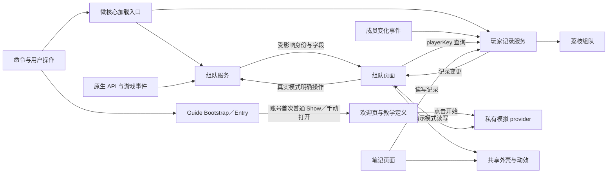

# 荔枝组队 · Lychee LFG 程序架构

更新日期：2026-10-24。

状态：当前发布版本为 1.2.5；本版采用启动时固定主题。主题启动固定、实时偏好和业务状态分别管理，架构改造以 main 提交 `5ce215182c15b59e44c573db9a1a6488536bb8bd` 为默认界面等价基线；此后用户指定的布局和交互调整按产品、设计文档维护。验证方法见 [tests/theme_reload.md](tests/theme_reload.md)，开发规范见 [Development.md](Development.md)；本次及历史验证集中记录在 [perfermance.md 第 12 节](perfermance.md#12-当前性能验证与历史结果)。

产品范围见 [Product.md](Product.md)，视觉与动画轨迹见 [Desgin.md](Desgin.md)，资源额度与测量方法见 [perfermance.md](perfermance.md)。历史 `.lycheedev/` 链接指向未随仓库分发的本地调查记录。

## 1. 架构决定

使用 WoW 原生 Lua UI，建立自己的启动入口、业务状态和界面。产品业务采用 `LycheeGroup` 命名体系，独立通用库采用 `LycheeUI` 命名。

LycheeGroup 的五个 AddOn 分别为微核心、组队业务、玩家记录、统一界面和使用引导；[LycheeUI](https://github.com/Follen/LycheeUI) 在独立源码目录维护，发布时复制进主包 `Libs/LycheeUI`，由主包 TOC 引用 `embeds.xml`，游戏插件列表不新增独立库。依赖只从产品指向共享库，业务数据和平台业务 API 留在产品层；参数、公开方法和回调的隔离规则见 [Development.md 第 4 节](Development.md#4-lycheeui-与产品严格隔离)。共享库不保存业务状态，不声明 SavedVariables 或登录事件；Context 拥有主题、控件、原生控件租借、动效和菜单实例，使用者按自身界面生命周期调用。模块可以在包内按职责分文件，不为每个页面、语言、动效或工具另拆子插件。

Group 包内置 LibSpecialization minor 28 和 LibStub，加载顺序为 LibStub → LibSpecialization → Group 与 Roster；已有同版或更新版时复用共享实例。LibSpecialization 保留原名称、版本选择和通讯协议，本地修补仅复用 Retail 自动回应的当前天赋字符串，公开读取仍即时取得原生值。来源、许可证与修补范围见 [Libs/README.md](addon/LycheeGroup_Group/Libs/README.md)。

Host 通过 `Context:SetWindow(frame)` 接入主窗口并捕获动画终点锚点。主窗口的通用拖动由 `LycheeUI.C.Draggable` 管理，应用仅登记外壳、品牌及具有 hover 的被动背景区域；子级交互控件自行接收输入。拖动结束将当前锚点交给同一 Context 的 Motion，开关动画沿该锚点运行，位置只保留于当前会话。Logo 纹理与播放控制由产品持有，不登记到共享 Context。

多列表格复用 `LycheeUI.C.TableHeader`：组件持有表头、边界、拖动状态和排序字段，当前排序标题提亮、不显示箭头，页面通过 `onLayout` 更新行几何、通过 `onSort` 重排展示键。右键分隔线调用 `ResetWidths` 清除该表比例并重新布局，不修改排序。`UI:GetTablePrefs` 从 Appearance 的有效配置缓存取得每表的列宽比例与排序字段／方向；用户拖动和点击由组件偏好回调提交角色用户层，程序重排不保存用户覆盖。Preview 使用自身 provider.prefs。Find 的团本和其他活动使用各自布局，结果与申请表均显式包含 `activity` 列；Appearance 仅在首次导入尚未规范化的角色旧列宽时，将仅有 `title` 的组合比例按 45%／55% 分给 `title`／`activity`，保留其他列与排序。已有规范用户值和偏好包均按单列语义使用，不从来源类型猜测旧组合宽度；1.2.4 已导入且无法区分来源的值也以规范保存值为准。后续 API 单键写入及兼容镜像不重新触发拆分。Create 根据活动切换可见列。Host 在关窗、导航、字体切换和打开模态窗口时取消未完成拖动。结果、历史和笔记服务仍持有原始数据；页面不重排服务数组。结果服务与 Find 表头排序共用同一关系口径：已归一化的战网好友、角色好友及公会聚合计数。Find 在产品层接入活动表头三态点击，并按当前分类的 `Catalog:GetGroups` 顺序派生活动 ID 到副本序号的映射；只在活动排序时建立或按目录引用变化重建，离页清空，复杂度与复用约束见性能文档。`Results:GetProgressCount` 只读取并缓存当前结果的击败数量，结果失效时一并清除，详情读取也回填同一数值。

主包保存启动所需的小配置、明确入口、加载关系及跨包共用的静态展示规则。组队业务、玩家记录、界面和引导使用真实 AddOn 按需加载；不把整套代码放在主包后只延迟创建窗口。后台记录提醒无需加载界面，单独打开笔记无需加载组队业务。

每项业务只有一个状态所有者。游戏事件推动相关变化，可见页面订阅所需字段，后台功能只保留真实业务需要的数据和事件。组队与笔记通过玩家身份直接联系，不互相 hook 控件，不将理由复制到各条队伍记录。

主包 [Presentation.lua](addon/LycheeGroup/Presentation.lua) 在 Core 后定义 `A.GroupPresentation`，通过 Activity／Result／Member 纯函数为 Find、Create、Tooltip 和 Floating 提供活动与来源视图规则：名单模式、进度或评分、评分要求、成员详情入口，以及申请者评分和大秘境记录的显示范围。它不持有业务状态、缓存或事件，也不读取原生数据；listing、applications、applicants 和 roster 仍由 Group 服务持有。这些静态规则不要求 Group 已加载。

主包 [ActivityLabels.lua](addon/LycheeGroup/ActivityLabels.lua) 独立维护原生活动与难度名称的显示别名，`A.ActivityLabels.Display` 由 Find、Create、Tooltip 和 Floating 共用。它只接收公开字符串并返回展示文字，不修改 Catalog、Results、原生搜索条件或玩家文本，也不持有事件、缓存和游戏 API。映射属于产品，LycheeUI 只接收处理后的文字。

模块直接调用具名接口，不预建通用插件平台、全局广播总线、万能任务系统或多层兼容框架。加载、激活与清理使用明确函数与状态。

Notes 首次按需加载完成后，核心通过现有模块就绪入口通知已加载的 UI。当前可见 Find／Create 补上记录订阅并刷新标记；启停笔记沿同一入口同步订阅，离页释放。隐藏、退场和 Preview 不消费这次界面通知，也不为显示空标记提前加载 Notes。

Host 开始退场时调用笔记页的 `CancelPendingSave`，使草稿令牌失效并取消该编辑器的 PlayerInfo 请求。Find、Create 和 Notes 的展示订阅在退场中跳过重绘，活动目录更新也不重新取得原生输入；Notes 仅保留当前编辑记录已变化的标记，快速重开由 Enter 重读最新内容，其余业务状态继续由服务更新。

暴雪 API 的调用条件、频率和事件通过荔枝 Dev 的固定版本源码核实。本地读取与服务器请求分开处理，请求在明确入口合并并尊重原生限流状态，不通过常驻轮询或重试风暴维持同步。

共享组件在构造时接收固定主题、recipe、元素和 utility；业务继续持有活动选择、申请目标、收藏状态与成员身份。窗口、页头、侧栏与页面留白等产品尺寸，以及导航字号、品牌尺寸和时长，由产品两套主题默认声明，库只解析普通 token。悬停、按下、选中和禁用在已声明规则之间切换，字体与布局走专用实时入口。主窗与浮窗分别持有 Context，字体从各自基准应用增量及用户比例，不累计缩放。菜单、提示和原生输入读取同一启动来源；原生输入归还时恢复借用前快照并保留新宿主的改动。完整共享接口见 [LycheeUI API](https://github.com/Follen/LycheeUI/blob/v1.0.0/API.md)。

增强布局仍由 LycheeUI 持有原生对象的几何记录。`Layouts` 统一求解 Box/Row/Column，`Responsive` 为每个 Context 提供一个按需布局队列，并只连接实际父容器、内容和显隐依赖；`Elements` 与 `Styles` 编译固定条件并选择命中分支。读取、计算、提交和通知分批执行，失败与过期代次不会继续提交。原生锚点及固定 Box 不登记响应任务，菜单、动画和原生租约继续按各自生命周期管理。

设置页将行内容、屏蔽工具栏和列单元格交给共享增强布局，产品仍持有设置定义、文字、动作、列偏好和静态断点声明。屏蔽表头产生一次累计列边界，当前物理行池复用这些边界。共享列表的文字变高路径显式开启，完整业务 key 仍由产品持有；库只保留两个数值索引缓冲、单个测量文字对象及当前可见行，分批完成后按 key 和项内偏移恢复滚动位置。容量与任务预算见 [性能约束](perfermance.md)。

## 2. 五个产品包与共享库

顶部路由按页面顺序决定整页横向进入方向，旧页按原有 Leave 生命周期释放，新页复用原 Frame。下划线调用共享 `Motion:Rect`；难度、职责分段与可选列表导航使用 `C.Selection`，页面只提供目标几何和业务选中值。共享 `Reveal` 负责菜单及筛选容器的有限入场，同目标刷新继续已有任务。每个 Context 复用自身的几何、显隐与选择状态，隐藏列表直接更新终态；不复制页面、列表或业务数据来播放动画。

五个产品包与独立共享库的运行职责如下；本轮账号首次欢迎入口已实现，离线行为与源码边界检查通过，已同步游戏目录，等待重载验收，既有欢迎样式及教学流程保持；原生动态兼容性尚未实测。

| 包 | 职责与数据 | 加载条件 | 依赖 |
| --- | --- | --- | --- |
| `LycheeGroup` | 微核心：命名空间、小设置、入口、静态展示规则、字体选择、独立小地图按钮、固定加载表、冷启动恢复、业务唤醒及轻量浮窗 | 登录 | 内置 LycheeUI 定义；浮窗按需创建 Context 和控件 |
| `LycheeGroup_Group` | 原生活动目录、搜索、结果、申请、招募、申请者、原生申请音、大秘境历史队友；不含业务页面 | 打开组队页面，或存在真实组队业务需要跟踪（含大秘境活动进行中） | 主包 |
| `LycheeGroup_Notes` | 玩家记录、身份匹配、队伍提醒、记录变更与按需专精查询；不含界面 | 显式记录／查看／导入，或笔记启用且已有名单需要后台提醒 | 主包 |
| `LycheeGroup_UI` | 产品外壳与页面、游戏数据和原生输入适配、导入导出编解码；Theme／Motion 接入共享库，Components 持有产品组合控件 | 首次打开自有界面 | `LycheeGroup` |
| `LycheeGroup_Guide` | 连续流程控制器、真实目录选择与限时读取、私有 provider、临时 UI 适配与操作绑定及聚光视图；无独立 SavedVariables | 账号首次可用的普通 UI Show 自动加载并显示欢迎，或由设置／`/lg dev guide` 手动加载；点击开始才读取目录并创建 provider | TOC 仅依赖主包；Bootstrap／Entry 分别由主包／UI 的 TOC 跨目录加载，开始流程时按需接入 Group 与 UI |
| 内置 `LycheeUI` | 可复用普通／原生注册控件、主题、动效、菜单与共享素材；无业务存档或登录工作 | 函数定义随主包；Context、控件、菜单与驱动按实际使用创建 | 不产生独立 AddOn |

四个产品子包声明 `LoadOnDemand: 1`，主包不将子包作为强制依赖。引导入口是明确的跨目录例外：主包 TOC 末尾加载 `..\LycheeGroup_Guide\Bootstrap.lua`，UI TOC 末尾加载 `..\LycheeGroup_Guide\Entry.lua`；完整引导包中的步骤、provider、适配层与视图仍按需加载。`LycheeGroup_UI` 的 TOC 声明 `Dependencies: LycheeGroup`，不强制依赖两套业务包，由路由入口在进入目标页面前加载其业务：组队页需要 Group，笔记页需要 Notes，通用设置不强行启动两者。

统一界面包首次加载时，其页面函数定义会一起进入内存；这部分首开和保留成本如实计算。各页面的 Frame、展示数据、菜单、弹窗和派生表仍首次使用才创建。五个产品包保留后台、界面与引导的按需加载边界，同时避免逐页拆包带来的安装和维护负担。

```text
addon/
  LycheeGroup/
    Core、Configuration、Appearance、Theme/、Presentation、ActivityLabels、BrandMotion、Fonts、Bindings.lua／Bindings.xml、Minimap、Entrypoints、PartyRoleCheck、Floating、API、Adapters、最小 Locale
  LycheeGroup_Group/
    Group、Game、Catalog、SeasonScores、Search、Results、Applications、Listing、CreationPresets、RaidBuffs、Relations、Roster、RaidGroups、Applicants、Alerts、History、Locale
  LycheeGroup_Notes/
    Records、RosterReminder、PlayerInfo、Locale
  LycheeGroup_UI/
    Theme、Motion、Elements、Resize、Host、Components、Members、PlayerLinks、RealmSlugs、Tooltip、Native、Application、Preview、Find、Create、Notes、Settings、Transfer、Media、Locale
  LycheeGroup_Guide/
    Bootstrap、Entry（分别随主包／UI 加载）；Guide、Adapter、Provider、Bindings、Interactions、Data、View（完整包按需加载）
```

品牌原始文件保留在 [Media](Media/lychee-logo.png)，离线预览直接引用此处 PNG。品牌、职责、关系、活动与申请操作等产品素材位于主包 `Media`，由产品 `productMedia` 参数提供路径，浮窗无需加载 UI 包即可使用。通用图形、箭头、按钮符号和阴影源位于 [LycheeUI/Media](https://github.com/Follen/LycheeUI/blob/v1.0.0/Media)，运行时位于主包 `Libs/LycheeUI/Media`，由共享 `media` 参数提供路径。UI 子包 Media 保留关于页图片，以及专用阵营、收藏星标、活动图标、成员遮罩和三态尺寸拖动柄 TGA。拖动柄源图在 `assets/imagegen/resize-grip`，收藏源图在 `assets/favorites`，职责盾牌源图在 `assets/roles`，阵营源图及生成信息见 [assets/factions](assets/factions/prompts.txt)。五个产品包的 TOC `IconTexture` 统一引用主包的 `Media/addon-logo.tga`；素材设计见 [Desgin.md](Desgin.md#1-品牌与语言)。共享库源码位于 `D:/Code/wow/addons/LycheeUI`，与本产品独立。磁盘素材引用不需要加载业务 UI。

运行 `tools/Sync-LycheeUI.ps1` 从独立源码同步内置库，运行 `tools/Build-Addon.ps1` 生成只含五个产品目录的安装包。共享库的冻结状态与规则由 [.lock](https://github.com/Follen/LycheeUI/blob/v1.0.0/.lock) 维护；冻结时，同步脚本在复制前核对运行文件清单和 SHA-256，内容不一致便停止。产品内置副本不包含库 TOC、测试或说明文档，不手工维护第二份源码。其他插件的接入方式和公共接口由共享库 [README](https://github.com/Follen/LycheeUI/blob/v1.0.0/README.md) 与 [API.md](https://github.com/Follen/LycheeUI/blob/v1.0.0/API.md) 维护。

## 3. 加载、激活与退出

包加载状态和业务活动状态分开：包可以已经加载但没有活动业务。WoW 加载 AddOn 后不能通过关闭窗口卸载它，Lua 定义、存档和已创建的原生对象仍须按真实保留量计算。

加载器只维护固定包表与 `unloaded → loading → ready / failed`。加载成功后调用明确的初始化／激活入口，再处理当前用户意图；不依赖已经发生的 `PLAYER_LOGIN` 被重新触发。重复打开不积累大型待办队列，加载失败说明原因，不后台无限重试。

冷启动只把进行中的申请、邀请或待处理状态视为 LFG 业务；原生应用列表中的已拒绝、已接受和已取消条目不会单独唤醒 Group。

主包 `PartyRoleCheck.lua` 独立接入队员的预组队职责确认，不依赖 Group 或 UI 已加载。收到 `LFG_ROLE_CHECK_SHOW` 后读取 `Core.charPrefs.applicationRoles`，只在非队长、非战斗且 `C_LFGList.GetRoleCheckInfo()` 明确为预组队时安排一次下一帧处理；原生弹窗完成初始化后，重新检查身份、职责可用性、各职责按钮及原生组合校验。提交沿用原生 `SetLFGRoles`／`CompleteLFGRoleCheck` 顺序，保留 leader 标志，仅明确成功后隐藏原生弹窗；失败还原原生职责并保留手动入口。当前确认只尝试一次，`LFG_ROLE_CHECK_HIDE` 取消待处理任务并释放临时监听。职责偏好仍由 UI.Application 写入，桥接只读当前角色存档。原生流程依据 wow-ui-source `e7aa82019dc298e0351c7159d60c2a9b916b9b67` 的 `LFDFrame.lua`，离线覆盖见 `tests/test_party_role_check.lua`；游戏内提交权限和真实多人事件顺序待实机验证。

原生组队眼睛的显示与点击接入由 Entrypoints 持有。账号设置 `nativeLFGEntry` 只控制隐藏入口：隐藏时以透明且不响应鼠标的方式接管按钮，关闭已有队列 tooltip；不 Hide 按钮，保留 EyeHighlightAnim 的原生声音循环。一次 OnShow、SetAlpha 与 QueueStatusFrame.Update hook 同步显示状态；按原生规则遍历 GetLFGMode，在任一分类存在 mode 且 submode 不是 noteleport 时释放接管，保留副本匹配、职责确认、就绪邀请和副本内传送入口，即使仍有预组队招募或申请也显示。所有此类状态结束后恢复隐藏；关闭设置同样恢复接管前的透明度和鼠标响应。按钮未加载时仅等对应 ADDON_LOADED，绑定后退订，不预加载业务界面。

绿眼睛的 OnClick 在按钮就绪后安装一次分流，与隐藏设置独立。左键从 `C_LFGList` 读取当前招募和活动申请，已有招募调用 `Open("create")`，否则以首个 applied／invited 的 `applicationID` 调用 `Open("find", context)`；无预组队时左键交回原回调，保留普通副本匹配的队列菜单和正在进行的战场计分板。右键同样原样交给原回调。预组队左键不调用 `LFGListUtil_OpenBestWindow`，因此不会同时触发集合石等插件在该函数上的开窗 hook；如原生窗口已显示，先隐藏以交还输入，荔枝打开失败则恢复。该分流只在点击时读取，不复制 Group 状态、不新增计时器，按钮等待与显示共用原有事件 Frame。原生分支与按钮类型参考 wow-ui-source `15881d522c44cd106d3d8660106ec9f9d2f44167` 的 QueueStatusFrame.lua／xml；替身验证见 `tests/test_native_queue.lua`。

Host 在从 find／create／notes 进入 settings 时保存本次会话的 `settingsReturnPage`；同页重复进入不覆盖它。设置按钮在 settings 上将该页名交回已有 Open／Navigate 路由，无来源时使用 GetDefaultPage，不另建页面栈或持久化字段。

独立 `Minimap` 持有本插件小地图按钮及拖动状态，与原生组队眼睛路由分开。主配置 `minimap` 默认 true，`minimapAngle` 保存位置；左键开关主窗、右键打开设置。显示开关显式调用 Show／Hide，使小地图按钮收集器的同名钩子同步记录显示意图。左键、快捷键与 `/lg` 共用 `A:ToggleWindow`，按 Host 的可见及退场状态决定关闭或调用 `Open(GetDefaultPage())` 反转开窗；`UI:IsShown()` 仍表示实际可见。`GetDefaultPage` 在每次普通打开时读取 `C_LFGList.HasActiveEntryInfo()`，当前队伍有招募即进入 create，不检查自身管理权限；独立浮窗和公开 API 的无页名 Open 也走同一入口，第三方适配沿用该 API。显式页名及定位上下文不改写。拖动期间才安装位置更新的 OnUpdate，停止拖动即移除并保存角度；按钮被收集器重新托管时不强行改回小地图锚点。

[Bindings.xml](addon/LycheeGroup/Bindings.xml) 注册 `LYCHEEGROUP_TOGGLE` 动作，由 `A:ToggleWindow` 路由；[Bindings.lua](addon/LycheeGroup/Bindings.lua) 持有主键、冲突和默认初始化入口。PLAYER_LOGIN 在当前账号／角色绑定范围内尝试一次默认键，`bindingDefaultScopes` 记录已尝试范围；容器损坏时通过 Configuration 保留原值并恢复空表，不替换玩家已有绑定。战斗时只延迟到一次脱战事件。改键使用该动作的原生 context，保留第二键并按 GetCurrentBindingSet 保存。Settings 仅在可见时订阅 UPDATE_BINDINGS，由设置行临时接收键盘输入，冲突复用 Notice 并在玩家确认后写入；Esc、切分类、离页、隐藏和战斗开始都释放键盘捕获及临时冲突状态。

Settings 持有鸣谢分类、静态名单、头像及用户提供的平台链接；底部入口复用分类导航，首次选择时创建两位贡献者的控件。平台按钮复用 `C.IconButton` 与 `Tooltip:BindText`。Settings 为关于与鸣谢的每个条目按需创建一组行内复制控件，最多四组；当前链接、输入焦点与有限展开任务归页面持有，同条目的平台按钮共用一组。复制不请求网络，离页或隐藏时清空链接、焦点和任务。头像来自用户于 2026-10-24 提供的附件，平台图标逐字节沿用 Lychee 的 `Media/About/bilibili.tga` 与 `douyin.tga`；其 素材说明（本地参考：`../Lychee/assets/about/README.md`）记录了 Simple Icons 的 CC0 来源。头像与平台图标随 UI 子包发布，保留比例及透明度。该分类不加载 Group 或 Notes，也不创建设置项；控件生命周期见 [perfermance.md](perfermance.md#3-先明确工作何时存在)。

主配置 `uiScale` 保存主窗百分比。Settings 使用共享 `C.Slider(...,{commitOnRelease=true,onPreview=...})`，库负责手动轨道、固定拖动尺度、步长及采样生命周期；页面按当前字体测量百分比标签宽度并缩短滑轨，保持操作区右对齐，在提交回调中保存设置。松手先停止采样再提交，隐藏或离页调用 `FinishDrag(false)` 取消预览并恢复拖动前值。Host.FitToScreen 将其乘到既有屏幕适配比例，设置变更、重开、筛选面板开合或屏幕变化时应用；筛选面板位于主窗内部，不增加屏幕适配宽度；主窗关闭屏幕边缘钳制，允许移出屏幕；模态窗口继承父窗尺度，Tooltip 按既有相对比例重新定位。浮窗仍由 Floating 的独立比例控制，主窗缩放不重写 `floatingScale`。

核心在 `ADDON_LOADED` 收到自身存档后，由 `LoadDB` 初始化 `Locale`，将账号语言设置中的“跟随游戏”解析为 `zhCN` 或 `enUS` 并固定本次运行语言；各包通过 `A:GetLocale()` 构建当前语言文本。核心字体选项在枚举时、浮窗在构建时读取该值，不能在源码加载时提前决定语言。修改设置只保存下次启动选择，重载前已加载与后加载的包继续使用同一种语言。Locale 随各自业务包加载，不新增独立语言 LoD 包。

核心 `Fonts` 通过 `GetSetting("font")` 解析分层配置：`default` 经 `GetDefaultPath` 按本次运行的 `A:GetLocale()` 选择主包 `Media/Fonts/LycheeFont-zhCN.ttf` 或 `LycheeFont-enUS.ttf`；中文文件完整保留原字体，英文文件以 Inter 为主并补全中文玩家名所需字形。`game` 指向游戏默认字体，其他值保留原有游戏字体或 LibSharedMedia 路径。语言改动随重载一起更新默认字体，已有自选路径不变。内置字体的来源、授权和构建见 [Fonts/README.md](addon/LycheeGroup/Media/Fonts/README.md)。账号配置 `fontScale` 保存 70–130 的百分比，`Fonts:GetScale()` 返回 0.7–1.3。新建主窗与浮窗 Context 使用所选路径和比例；设置改变时只更新 Context 已登记且仍属于本插件的文字及当前持有的原生 lease，重算基准字号和行高，保留字体标记，不修改全局 FontObject 或其他插件控件。原生 lease 刷新自己的已应用快照，归还时恢复借用前字体；转交其他宿主的输入不被重设。Host 在主窗显示后及字体切换后统一重测顶部导航、设置按钮与下划线，并在下一帧校正尚未就绪的文字度量，避免一直沿用隐藏建窗时的零宽度。Find、Create、Notes 与 Settings 重新测量相关文字布局；申请弹窗在打开时按当前字体重测职责与操作按钮。此服务不为枚举字体加载 Group、Notes 或业务页面。

主包 TOC 随自身加载内置库函数定义；WoW 的 `LoadAddOn` 以 AddOn 为单位，不提供本项目可用的任意包内 Lua 文件加载接口。浮窗启用时才创建其 Context 和控件，此路径不加载 LycheeGroup_UI。关闭浮窗不能卸载已经加载的库定义；库成本归主包计入当前五包总量。此前独立库五包测量保留为历史口径，不直接与新布局的主包数字比较。

首次打开前按目标页面加载依赖。搜索、申请和邀请等依赖硬件事件或受保护时序的动作保持合法调用链，不能统一丢进 timer。战斗中没有整窗门禁，也不自动隐藏窗口；具体限制在平台接入点核实，不排队重放过期动作。Esc 通过 `UISpecialFrames` 的关闭请求进入 Host，优先取消设置行录键或冲突提示，再依次关闭当前弹窗、固定提示、菜单、活动选择器、筛选和主窗，保留清理与退场。首次在战斗中构建查找页时，只把键盘传播设置延后到一次脱战事件；鼠标操作和已初始化的快捷键不受该初始化步骤影响。行内提示触发区只接收移动与进出事件，将行反馈交回所属行，不调用受保护的鼠标点击／移动传播设置。

| 状态 | 需要的工作 | 不应连带加载或继续的工作 |
| --- | --- | --- |
| 登录，未使用且无活动业务／名单 | 小配置、命令、必要唤醒入口；随主包加载库定义，浮窗启用时创建入口与弹层外壳，内容按展开需求建池 | Group、Notes、LycheeGroup_UI、活动目录和业务页面 |
| 笔记启用、已有记录且提醒开启 | Notes 数据与入队提醒；登录核对当前队伍 | UI、Group、完整名单排序、导出文本 |
| 只打开荔枝笔记 | Notes、LycheeGroup_UI，创建笔记页面 | Group、组队页控件 |
| 打开寻求组队／创建组队 | Group、LycheeGroup_UI，创建目标页面；已有记录且启用时查询 Notes | 无理由创建笔记页／导出弹窗 |
| 关窗但申请／招募仍活动 | 对应业务状态、结果监听与必要通知 | 行刷新、排序、提示、输入与无用搜索快照 |
| 关窗且组队业务结束 | 已加载定义、小设置、按需保留的笔记提醒 | 周期刷新、空转 ticker、历史结果链与失效回调 |

主配置保存 `notesEnabled`、`notesHasRecords` 等小摘要供冷启动选择，不复制名单。Notes 写入、删除和导入时同步摘要；记录仍以 Notes 的唯一存档为准，初始化时核对摘要。停用自动提醒后登录不加载 Notes；首次进入真实 Find／Create 页面时，页面的 WatchNotes 通过 UI:PrepareNotes 按需加载已有记录，保留成员标记、详情与记录操作。可见页面重新启用笔记沿用同一入口及模块就绪通知，只订阅一次；预览不加载真实记录。原生玩家菜单也在查询已有记录前按需加载，名单管理仍可随时打开。

`ADDON_LOADED` 只初始化主包自身一次；原生组队按钮尚未就绪时继续等待 `Blizzard_QueueStatusFrame`，绑定入口后退订。`PLAYER_LOGIN` 只执行一次。冷启动对原生仍存在的申请／招募做必要恢复；大秘境仅在历史记录启用时恢复。空闲时主包保留申请状态与招募变化唤醒，秘境开始监听随历史设置启停；尚未加载 Group 时中途开启历史，会立即接管当前进行中的秘境。若是 CHALLENGE_MODE_START 首次唤醒 Group，或本次会话在秘境中显式启用记录才加载 Group，Entrypoints 在初始化后丢弃恢复出的旧基线，再交给 History 建立本次记录；登录时已经进行中且记录开启的秘境继续按原存档恢复。Group 初始化完成后主包撤销这些监听，由 Group.Game 接管；搜索监听随 `Attach/Detach`；Group 加载后保留活动可用性事件，使隐藏期间的目录也能失效，目录请求在同次登录内由所有页面共用一次；申请者监听随真实招募启停，不让两套处理器推进同一状态。

### 3.1 使用引导的所有权与退出

教学逻辑全部位于 `LycheeGroup_Guide`。`Bootstrap.lua` 随主包 TOC 加载，建立 `A.GuideEntry` 并向通用 `A.DevCommands` 表注册 `guide` 处理器，接收 `/lg dev guide`；`Entry.lua` 随 UI TOC 加载，由 `A.GuideEntry` 持有账号首开欢迎判断、动态加入的常规设置行及入口状态；旧轻提示和相关字体刷新租借全部移除。冷启动只加载 Bootstrap 定义，不加载完整 Guide；账号首次可用的普通 UI Show 才自动按需加载完整 Guide 并显示既有欢迎页。手动设置／命令使用同一欢迎入口，不接受路线参数；欢迎只展示，点击开始才读真实目录和创建 provider。Entrypoints 只实现通用 `/lg dev` 分发，不直接引用引导；玩家命令仅保留 `/lg` 开关窗口，原玩家子命令及 `/lycheegroup` 别名移除，功能保留界面入口；测试场景和浮窗检查分别使用 `dev test`、`dev floattest`，`/lg dev` 显示测试清单。原四包 Lua 相对功能开始基线 `c03b501` 仅允许本次独立命令调整，包括分发、帮助文案和普通 Preview 用法提示；教学逻辑不改原 UI／Group Lua，仍通过 TOC／XML 加载新文件，不增加 `A.OpenGuide` 或 `A.MODULES` 条目。加载完整引导包只建立定义，不读取目录，也不创建 Frame、事件或定时任务。

`Guide.lua` 持有连续步骤、当前阶段和完成状态；依次覆盖寻队、申请中的治疗与自动申请选择、实际切到创建页及创建操作，最后调整窗口尺寸，不持有教学浮窗。`Data.lua` 的 `ResolveActivity(Group.Catalog)` 在流程启动时优先选择真实赛季地下城，返回原活动、分类和分组对象；无可用目录则返回错误，不提供负 ID 替代副本。`ResolveTimeLimit` 按活动 mapID 匹配挑战模式静态地图资料，仅保留最近一个成功结果，不读取角色成绩。`Provider.lua` 的 `CreateProvider` 接收真实 catalog／activity／category 与样例玩家，独立建立六支队伍和三个申请批次的私有对象图；不读取真实角色资料或执行原生业务写操作。搜索按当前真实活动原地重绑固定教学记录；有关系的教学队伍使用固定乱序评分，排序仍走既有关系优先和评分比较，不增加教学专用排序捷径。`Adapter.lua` 使用既有页面的 Begin／EndPreview 接入 provider；普通 `Preview.lua` 仅随开发命令更新用法提示，业务行为及真实 `A.Group` 服务对象保持原样。

`Adapter.lua` 只在教学会话中租借既有 UI 方法，隔离教学偏好（含自动申请）、阻止教学尺寸保存，并观察关闭与切页；只允许当前阶段要求的寻队到创建切换继续流程，其他外部导航结束会话。教学期间临时抑制普通 Tooltip，仅允许当前队伍详情；退出时仅在方法仍为本轮包装函数时还原，保留外部接管。首次欢迎入口和设置行仍归 `A.GuideEntry`，不写入普通 Host／Settings 源码。

`Interactions.lua` 根据当前步骤选择临时绑定、执行原回调之后的状态检查，并处理事件驱动的目标、Tooltip 与卡片避让区域几何更新；`Guide.lua` 持有连续步骤、阶段和推进状态。申请的 `RecoverPhase` 在阶段 2–4 发现 `appliedID` 已生效且弹窗已关闭时，保留该 ID 并进入阶段 5 取消；只有未提交的关闭才回到阶段 1。提交关闭触发同步 `UpdateStep` 重入时沿用同一恢复规则，避免已申请记录遗失后反复提交。`Bindings.lua` 仅租借原生 `SetScript` 回调：先执行原回调，再调用当前阶段观察器。切换阶段或退出时，只有当前回调仍为本次包装器才归还原回调，外部接管的回调保持原所有权。此路径不安装永久 HookScript，也不要求每个普通 UI 操作分发教学事件。尺寸阶段复用现有 resize driver；推进与几何更新共用单个可取消的零延时任务。悬停后再排一次几何更新，以取得原生 HookScript 在主回调之后显示的提示。

寻队详情阶段只观察队伍左侧悬停打开及原有移出逻辑完成后的收起。搜索来源保持 `GroupPresentation.Member("search").canOpenDetails=false`，引导不创建成员点击入口或修改正式展示能力。创建页申请者原有的个人资料能力保持，当前流程不额外教授此操作。

账号主存档的 `guide.welcomeShown` 在欢迎页首次成功显示后写入，手动先开也消费首次；已有 welcomeShown、dismissed 或 completed 均抑制后续自动加载。状态沿用现有账号 SavedVariables，不查询战网身份或增加网络同步。预览、战斗、既有 modal、hiding／opening 不消耗机会，下次可用普通 Show 重试；加载失败不写 welcomeShown，且本会话不反复自动加载，不安装重试 timer／event。其余完成元数据继续按完整流程保存，不存教学队伍、申请或玩家记录。Adapter 保存来源页及窗口几何，正常退出恢复；教学中的列宽、排序、筛选、侧栏和尺寸操作只写私有会话。尺寸保存拦截仅在 Guide 会话中生效，普通预览沿用原有实现。完整实际操作顺序见 [Product.md 第 5.4 节](Product.md#54-使用引导)。

当前阶段另提供 `ContextFrame` 作为卡片定位的几何参考，覆盖完整活动 picker、表头与结果列表、申请列表、筛选面板或职责弹窗等操作区域。该参考只参与卡片避让，不创建额外点击镂空。`RevealFrame` 独立替换主透明孔的几何范围：详情／申请入口使用整个结果列表，评分排序使用表头到列表底部的评分列，创建阵营／用时使用整个申请列表；红框仍按目标定位，当前队伍详情保留第二个交互孔，总计仍为两个孔、最多九块遮罩。`View.lua` 排除与目标、ContextFrame 及 Tooltip 重叠的位置后，在屏幕内按离目标距离就近放置，允许主窗内位置，不再优先外侧；保留字号并调整宽度和内边距，仍放不下时只隐藏卡片，保留 Guide 步骤及交互观察状态，后续几何更新恢复显示，不走退出清理。

`View.lua` 首次展示才创建有界复用视图，为目标和当前队伍详情同时保留交互区域。选本阶段默认 M+，按真实目录可用数量观察不同副本勾选与确认，不限制固定行；无 M+ 使用普通地下城。治疗筛选观察面板或已启用的顶部条件，不再观察人数输入。欢迎页居中标志复用现有 `CreateBrandMotion` 的有限跳动与悬停重播，减少动态效果下静止。活动期注册战斗监听；退出、外部切页／关闭或战斗会取消任务、清理阶段绑定和目标／RevealFrame／ContextFrame／provider 引用，隐藏已有视图供下次复用，并停止欢迎页品牌动效、归还提示抑制和其他临时租借。普通状态不增加引导专用 OnUpdate 或轮询。具体容量和测量要求见 [性能文档](perfermance.md#3-先明确工作何时存在)。

## 4. 状态所有权与数据流

主窗尺寸由 [Resize.lua](addon/LycheeGroup_UI/Resize.lua) 管理：`layout.window.width/height` 由配置服务保存当前角色偏好的宽高，旧 `charPrefs.windowSize` 仅作为迁移来源与持久用户修改的兼容镜像，`windowWidth/windowHeight` 表示经屏幕和页面下限约束后的实际尺寸。Host 构建时读取、导航及屏幕适配时应用；只有拖动结束写回偏好，临时布局限制不覆盖存档。最小尺寸随字体比例及创建表单内容计算，屏幕适配也保证最小布局能放入屏幕。三态拖动柄按住时读取鼠标并固定左上角，松手、隐藏或离页停止采样；不改写整体缩放和字体设置。页面反馈通过 `RefreshWindowSize` 应用尺寸约束，拖动期间采用当前宽高，避免输入校验恢复拖动前的偏好。`LayoutWindow` 只调整当前页面的 `LayoutSize`，各页复用现有控件，保留输入和业务状态。随视口扩大的共享列表使用 `SetRowInitializer` 初始化现有及后续新增行，按实际可见需求扩充后复用。



| 所有者 | 权威状态 | 消费方式 |
| --- | --- | --- |
| Group.Search | 当前条件、搜索请求和代次 | 发起搜索，只提交当前相关结果 |
| Group.Results | 当前完整合法结果、必要元数据、搜索代次、会话标题规则与账号队长屏蔽名单 | 按身份读取，筛选／排序产生 ID 顺序，不深拷贝全库 |
| Group.Applications | 所有分类已提交申请与邀请状态、原生到期时刻、终态展示清理、会话拒绝时间和单个自动接受中的邀请 | 全局五项额度；独立于页面寿命，实际结果驱动状态；拒绝时间按原生 partyGUID 保存 |
| Group.Listing / Applicants | 当前招募与申请者、各成员全部 requestedRoles、assignedRole／specID、终态展示清理 | 报名职责独立于分配职责和当前专精；更新具体记录，原生仍活动但详情暂缺时保留最后确认的招募快照，原生确认结束后清理所属数据 |
| Group.CreationPresets | 账号级 `Group.db.creationPresets` 收藏数组 | UI 通过 Find／ToggleFavorite／Remove 匹配、切换和移除条件；Listing 不写入收藏 |
| Group.History | 当前角色大秘境历史 run 与进行中活动的成员基线 | 活动事件驱动去重记录；活动结束退订队伍监听，不周期扫描 |
| Group.Alerts | 当前招募的未查看标记及可见申请列表的所有者集合 | Applicants 的新增申请触发；列表查看、待处理申请清空、权限丢失或招募结束清理原生申请提醒 |
| Group.RaidBuffs | 当前活动与成员职业／小队形成的职业增益缺口 | Roster 调用独立统计模型，Preview 复用同一模型，无新轮询 |
| Group.Roster | 当前成员快照、按 GUID 保存的库同步专精／检视结果与单个检视请求、职业／小队统计输入 | LibSpecialization 回调与游戏事件使快照失效；创建页需要且缺专精时才检视；装等独立接纳已有原生值，复用当前 GUID 缓存 |
| Group.RaidGroups | 当前团队成员换小队的落点判断、动作检查与原生提交 | 预览与动作共用身份、权限、容量和战斗校验；提交时按 GUID 重新解析 raid 索引，不保存名单副本或乐观结果 |
| Group.Relations | 当前观察者的 GUID／角色全名关系位图、短名索引、当前战网好友的轻量身份与一个可取消任务 | Apply 为成员补充独立关系字段并排除自身；ApplyMembers 按同批次姓名消歧；角色好友、战网、公会事件只使对应来源失效，指定战网好友变化只重读其游戏身份；通知可见消费者，无消费者时全部释放 |
| Notes.Records | `playerKey → record` 持久记录、总数及三类数量 | 唯一读写入口，命中后按需读取理由；导入与初始化共用有限时间戳边界，绑定时与身份索引同轮计数，写入时增减四个标量 |
| Notes.RosterReminder | 当前成员 GUID／已知姓名、待解析单位与去重集合，收邀事件和一次安全出邀 hook | 按当前单位对账成员身份，暂不可读时保留对应身份；成员差异及邀请触发本地提醒，离队清集合，停用退订，hook 静默 |
| Notes.PlayerInfo | 单个待完成的单位／GUID 查询、回调和超时任务 | 先借用已加载 Roster 的专精缓存，再读取原生检视；不另存结果缓存，完成或取消后释放请求 |
| Guide／Provider／Adapter | 连续步骤、独立样例队伍／申请／角色状态、临时 UI 方法及恢复快照 | 既有页面消费私有 provider；Adapter 按函数身份归还租借方法，退出恢复页面与几何并清理引用；账号仅存完成／提示元数据，入口状态归 GuideEntry |
| UI.Native | 搜索及创建表单的原生输入租借、原生创建校验 | 显式绑定／释放 Search 的输入 token，原生控件失去所有权时通知页面 |
| UI.Application | 当前角色的自动申请开关、多职责偏好、当前申请 lease 和申请弹窗 | 主界面与弹窗共用状态；有效保存职责可直接开启，否则确认后开启；原生备注仅留安全字段；配置变更通过一个回调通知 Find |
| UI.Tooltip | 当前来源、所选成员身份、固定／展开状态、团队拖动与落点反馈、复制弹窗返回快照及复用的短说明控件 | 自行重新解析最新成员；BindText 为按钮接入共享 C.Tooltip，按当前字宽调整短说明尺寸，与详情提示统一所有权及关闭生命周期；页面不写入内部字段 |
| 各页面 | 活动单选／多选草稿、滚动、可见行身份 | 确认后提交搜索选择，订阅所需变更，不另建业务状态机 |

Notes 初始化原位核对当前记录容器及条目，缺失、非有限或原生日期函数无法显示的时间统一记为未知 `0`；可用记录继续保留原引用。无法消费的容器或记录移入同一存档的 `invalidRecords`，以 `{key, value}` 保留原来源和内容，不参与名单、提醒与导出。笔记存档根异常以 `key="$root"` 保存原值和 `error` 原因，首次缺失不记错误。旧 schema 迁移采用相同时间边界，合并仅检查导入身份及命中的已有记录；排序复用已验证时间，不重复格式化日期。Notes 另持有大小写折叠身份到实际存档键的索引，优先使用原生 `C_Intl.FoldCase`，不可用时按 ASCII 折叠；Core 身份格式、原键和显示姓名保持原样。查询、编辑与删除优先匹配精确旧键，其他大小写写法选择有效时间最新的匹配记录，同时间按实际键升序选择；旧碰撞记录均可独立管理。新增与合并按该逻辑身份去重并拒绝记录自己，保留已有展示姓名。Find 同时返回实际键，笔记页据此选择、编辑和处理通知。

Core 先核对账号与角色存档根，非空异常根由 Configuration 保留到新根的 `uiConfigRecovery["$root"]`；在 Configuration 绑定前清理已废弃的声音与关键词设置，避免迁移快照保留无用列表。Configuration 在绑定时检查保存容器与实时偏好；非法原值保存在账号或角色根的 `uiConfigRecovery[完整路径]={value,error,previous}`，正常对象保留引用，恢复记录不进入旧设置快照。其余旧值快照供迟注册定义及自定义导入函数读取。写入旧设置兼容镜像时也检查路径容器，异常原值按同一方式保留，避免阻断已保存偏好的即时应用。Theme.Source 检查选中包外壳，Appearance.Compile 验证实际选中值与覆盖并返回具体错误，交由启动入口回退；查询不重复编译全部主题。

创建收藏的异常容器保存在 `creationPresets.invalidContainer`，异常数字键条目移入 `creationPresets.invalidEntries`，按 `{key,value}` 保留来源；有效收藏继续使用原对象。旧玩家收藏迁移只处理有效条目，异常条目留在原位置。

Group 初始化时校验旧账号筛选、当前角色筛选及职责、屏蔽名单和大秘境历史。账号及历史存档的异常原值写入各自 `storageRecovery[路径]={value,error,previous}`；角色偏好使用 Configuration 的 `uiConfigRecovery`。合法筛选容器、历史条目及成员保持原引用；坏历史条目整体隔离，仅在出现空洞时压紧原数组，不按数量裁剪。进行中历史同时核对成员表和唯一完整的顺序表，异常基线隔离后按当前真实秘境重新接管；可选的未知层数、地图名称与时间继续保留未知含义。隔离内容不进入正常读取和重复初始化扫描。

Find 的非五人结果与申请行从 Results 分别读取职责人数、队长职业和进度，不构建完整成员快照。`GetLeaderClass` 优先复用干净详情，再尝试原生队长接口；只有公开的队长标志和有效职业同时存在时才采用。接口缺失或数据不完整时，按原生成员顺序读取到首个队长标记／完整队长身份命中；缓存包含暂时未知的职业。结果更新沿既有详情失效路径清除这些摘要，完整详情读取回填同一缓存。五人头像和 Tooltip 仍通过 `GetDetails` 取得完整名单与关系信息，摘要不能冒充完整详情。

Applications 的摘要使用独立 `GetFlaggedLeaderClass`，保留首个公开 `isLeader == true` 成员的职业语义，不混用按名字推定的队长缓存。已有干净详情可直接消费；否则逐成员读取到该旗标即停，只存职业及已读取标记。原生更新同时使严格摘要及详情失效，完整详情由实际消费者按需原位刷新。Notes 管理页通过 `GetCounts()` 读取数量，不另建类型索引或在单条编辑后扫描完整存档。

首次捕获结果时，Results 接管本次原生查询返回的独立表，移除不消费的字段并写入标准字段；再次更新继续使用已发布 record 的身份，不以新的原生表替换消费者持有的对象。搜索换代检查发生在接管前，旧代次不再加工数据。浏览缓存跨搜索不复用 record 或队长职业摘要；有效申请独立持有当前 result，允许继续引用已按需读取的同一详情容器，随该申请记录移除或退役释放。隐藏更新仍只刷新摘要，不主动补完整成员。

Listing 更新跨阵营时执行下架再创建。即使创建失败，也在 Update 返回前同步原生招募快照并通知消费者；Create 在提交期间保留编辑草稿，随后只切换为可再次发布的表单。提交错误由页面状态持有，被动招募通知不清除错误，用户修改输入或再次提交时重新校验；预览沿用独立页面状态。Create 独立持有装等纠正 Notice 和单个到期任务，与失败 Notice 分别保存消息、共同计算表单让位；到期发生在退场期间时仅标记过期，快速重开再隐藏，表单隐藏或离页时释放提示和任务。设置彩蛋提示沿用相同到期处理，Host 不再持有底部 Toast。

Listing 在当前角色偏好 `listingAutoInvite` 保存本插件的自动邀请选择，成功发布／更新后写入，失败保留原值，原生确认招募结束时清除。招募快照的 `autoInvite` 与原生 `autoAccept` 分开：创建表单和收藏使用前者，原生标记为真时由游戏处理邀请，明确为假时 Applicants 在已有申请、招募及队伍事件中调用同一 Invite 动作。`acting` 区分邀请与拒绝，尚未取得原生状态的邀请先占用容量，状态变化后释放该占位；同一轮自动处理避免事件重入；自动邀请的展示通知复用现有延迟任务合并，手动邀请与拒绝保持即时通知。页面关闭不持有或停止这项业务。

Applicants 在邀请前核对当前招募活动、操作权限、申请状态、整组人数与剩余名额；手动邀请跨过五人上限时，由该服务持有一次转团确认和目标记录身份。接受确认后重新校验再提交，取消、招募结束、活动或目标替换使旧确认失效；等待确认返回独立的待决状态，浮窗保留对应条目。自动邀请每批共享一次容量计算，逐次按实际提交人数扣减，事件同步重入时才更新容量上下文。创建页活动期间，`PLAYER_ROLES_ASSIGNED` 沿既有队伍失效通知刷新快照，离页解除该展示需求。

`GetActiveEntryInfo` 的字段可在聊天消息限制期间变为 secret。Listing 在写入本地快照前过滤受限的文本、数值、布尔与枚举字段，保留公开的活动 ID；字段不可读时返回 nil，整条详情暂缺时仍保留已有快照。没有显式自动邀请偏好且原生开关未知时，`autoInvite` 也保持未知；已有偏好不被改写。Applicants 只在 `autoInvite == true` 且 `autoAccept == false` 时尝试代邀请，未知状态等待下一次原生招募事件。真实标题和说明的编辑继续由原生复制入口处理，不从 Lua 快照回填。

[Host.lua](addon/LycheeGroup_UI/Host.lua) 持有 `UI:GetGroup()` 和组队设置访问入口；显式模拟开启时选择 [Preview.lua](addon/LycheeGroup_UI/Preview.lua) 的独立内存 provider，否则返回真实 `A.Group`。Preview 按正式接口的聚合关系计数、队长查询规范化和有效申请状态筛选。页面与提示经同一入口读取组队数据；真实 Group 服务、原生登记输入对象和 SavedVariables 不被替换或写入。寻队与申请结果的右键记录在点击时重新取得当前结果，保留队长职业摘要，并从详情按完整队长身份选取成员、在该职业内解析专精；交给 Notes 的添加草稿仅携带姓名、服务器、记录类型与已知职业专精，不持有成员表。模拟命令与退出行为见 [Product.md 第 5.3 节](Product.md#53-显式模拟入口)，分配及释放边界见 [perfermance.md](perfermance.md)。

`Results:BlockTitle(title, leaderKey)` 保存本会话的原生标题键，并从当前完整结果中收集匹配队长，写入账号存档 `Group.db.blockedLeaders`；可选队长参数覆盖已经离开当前搜索的申请。标题键不解析或序列化，跨搜索稳定性由持久的完整 `leaderKey` 承担；后续归一化遇到仍可匹配的标题时补充新取得的队长身份。过滤只改变结果视图，不删除记录或修改 Applications。`GetBlockedLeaders` 在名单变化后重建并复用排序 key 数组；`RemoveBlockedLeader` 删除单个保存项，并用本会话例外防止旧标题规则立即重新加入；显式再次屏蔽匹配标题会撤销该例外。`ClearBlockedTitles` 同时清除标题、队长名单与例外，`GetBlockedTitleCount` 只统计临时标题。用户操作产生实际变化时使视图失效并发送一次 results 通知。Find 和 Settings 经 provider 调用这些接口；Preview 持有自己的临时数据，不影响真实服务或 SavedVariables。刷新、分类切换和 EndBrowse 释放搜索快照，保留屏蔽状态。设置仅进入“屏蔽”分区时按需加载 Group，分区可见期间订阅结果变化；关窗动画期间跳过通知绘制，重开同步当前名单，退出后退订。

Results 归一化原生 `partyGUID`，Applications 在活动申请快照中保留该身份。确认 `declined` 时，以 `GetTime()` 记录该队伍最近拒绝时间，优先用已保留身份；没有快照时只补读一份原生结果元数据。取消、超时、满员、下架和拒绝邀请不写入。独立的会话时间表不随五秒终态记录、搜索快照或页面释放而清除，重复终态不重置时间，新申请再次被拒绝才更新；重载后重新开始，不写 SavedVariables。

Results 重建结果顺序时，按完整队长身份查询已加载的 Notes，并在当前结果记录中保存本轮拉黑布尔值；关闭笔记自动功能时该值为 false。排序先把拉黑队长排在其他结果之后，两组内部再按 `Applications:GetDeclinedAt(partyGUID)` 将已拒绝队伍置后，随后比较已有的 `bnetFriends + charFriends + guildMates > 0`、当前排序键、发布时间和结果 ID。关系计数仍由原生结果更新链失效，不依赖本地 Relations 或成员详情。Find 的 `SortResultIDs` 使用同一顺序，在自身复用表中预先记录每个候选的拉黑值，再按表头数值或活动序号和方向重排；未知值置后、相同值按结果 ID 排列，离页清空临时表。笔记变化沿用可见 Find 的订阅使结果视图失效，不另发搜索。Preview 不读取真实笔记，保留自身的拒绝及关系优先规则；Applications 自身的申请排序不变。

Find 将 `hideSameSpec` 与赛季地下城的角色偏好一同保存，其他分类清除活动条件。Results 每次脏视图重建只读取一次 `Specializations:Player()`，在廉价条件通过后检查队伍成员；原生专精名通过 Group 的职业内解析取得专精 ID，不拿职责推断。已有干净详情时复用成员，否则直接读取必要原生成员；轻量结果缓存与生命周期见 [perfermance.md 第 5 节](perfermance.md#5-搜索筛选与结果数据)。搜索页可见时监听自身专精变化，启用该过滤时使结果视图失效并通知刷新。Preview 用样例成员的专精 ID 执行相同排除。Create 的申请者职责条件属于页面会话，选满三项时归并为无条件的“全部”；其余多选按任一职责命中保留整批成员，不改动 Applicants 的原始报名数据。

`PlayerKey` 统一名字和服务器的规范化与键构造，`UnitIdentity` 在原生单位读取边界过滤未知、非玩家和受限身份；两者不持有全服玩家缓存。远程 LFG 的 `RemotePlayerKey` 只接受原生明确的完整身份，不把裸名猜成本服玩家。记录写入确认单位仍对应该身份，异步专精完成确认 GUID。Group 的专精解析优先已知 specID，否则只在已知职业内精确匹配原生专精名；未知保留未知，不为图标编造字段。当前队伍以 `UnitIsUnit(unit,"player")` 识别自身的 `raidN` 等别名，自身使用当前专精接口与平均装等。

队友专精由 Roster 优先读取 LibSpecialization 回调缓存，其次读取原生检视结果。库回调的名字可能省略本服，先与当前真实成员身份匹配，再按 GUID 保存；不保存天赋字符串，不匹配队外玩家。库没有历史回放，公开 `RequestGroupSpecialization()` 已为空函数，因此不通过它重复发消息。Group 加载后接收库事件，创建页隐藏时仍可保存新广播；不会停掉其他插件共用的库监听。只要仍持有远端成员快照或专精／检视缓存，Roster 就持有成员变化事件；隐藏时只按当前 GUID 清除离队缓存与成员引用，不构建关系、重读成员资料或启动检视。最后一个远端缓存退出后释放该事件所有权，历史、招募等其他消费者独立决定是否继续监听。

`Roster:GetUnitSpec(unit, guid, isSelf)` 集中读取自身当前专精、队友同步缓存及未失效的原生／既有检视数据；Roster 构建与 History 采集共用此入口。它不调用完整 `Roster:Get()`、不启动通信或检视。匹配当前成员的库回调与已接受的检视结果通过 `History:OnSpecUpdate(key, specID)` 只补齐进行中记录的空专精；History 继续独占历史写入，完成后不追溯修改。

创建页活动期间，Roster 的原生失效事件与库广播复用 `refreshTimer` 合并展示通知和主动重建。事件处理立即标记 dirty，按当前 GUID 清理离队成员并取消失效检视；`Roster:Get()` 仍同步读取最新状态。页面停用取消待刷新，隐藏期间沿用原来的缓存维护路径。

广播即时写入 GUID 缓存并使成员快照失效；创建页活动期间，同帧多条广播合并为一个可取消通知。显式读取仍立即得到最新快照；普通失效或离开创建页取消待发通知，不留下隐藏页面刷新。展示合并任务与串行检视计时器分开持有。

创建页首次消费缺失专精时给库回调一次等待机会，之后通过 `CanInspect` 选择成员、串行 `NotifyInspect`，只在匹配 GUID 的 `INSPECT_READY` 后提交结果并通知界面。专精变化清除该成员旧值；新成员、重新上线及脱战事件重新推进尚缺的信息。原生检视窗口打开时让出，关闭事件继续；不调用 `ClearInspectPlayer`。离开最后一个创建页消费者取消本项目请求／计时器及检视相关事件。所有等待与节流参数只在 [perfermance.md](perfermance.md#6-招募申请者与通讯) 维护。

[RaidBuffs.lua](addon/LycheeGroup_Group/RaidBuffs.lua) 以活动目录 `seasonRaid` 为展示范围，由 `Group.Roster:GetRaidBuffs(activityID)` 提供结果；预览复用同一统计模型。输入为现有 Roster 的 class／subgroup：difficulty 16 统计前四小队，其他赛季团本统计前六小队，不以是否已经进入团队作为前提。模型覆盖十三职业，盗贼阈值为两人，保留未知职业的未确认状态；不检测光环、天赋或技能实际状态，不统计战复／嗜血。刷新沿现有 Roster 事件，无新轮询。职业覆盖设计参考 [NSRT SetupManager 固定版本](https://github.com/Reloe/NorthernSkyRaidTools/blob/94a1c01ddf3c34f9944c3976ae667e1d1b21226e/NorthernSkyRaidTools/SetupManager.lua#L531-L595)，本项目自行实现，未复制其源代码。

## 5. 事件驱动的实际边界

事件直接路由到所有者，依据参数定位受影响记录。`Group:Notify` 只分发变化通知；Game 根据创建页与活动招募维护本地关系监听需求，申请变化不承担无关副作用；`Group:Publish` 只负责发布招募。Core 保存设置后，仅把历史记录和自动进组的实际变化交给已加载的 `Group:OnSettingChanged`，通常不因此加载 Group；例外是开启历史时发现当前秘境正在进行，入口会立即加载 Group 并恢复记录。原有 Restore／Discard／TryAutoJoin 的同步时机不变。共享的受限值读取函数 `Group.Public` 在 Group 基础文件定义，具名服务及现有操作入口保持原合同。页面不可见时不生成展示对象；可覆盖状态按同一所有者／同一用途合并，不丢弃用户动作。

| 触发 | 所有者与处理 | 结束条件 |
| --- | --- | --- |
| 大秘境开始／完成、活动期间队伍变化 | Group.History 建立当前 run 与成员基线，去重记录队友快照 | run 完成写入历史；活动结束退订队伍监听，重登由冷启动恢复 |

| 触发 | 所有者与处理 | 结束条件 |
| --- | --- | --- |
| 用户搜索、结果到达／变化 | Search / Results 更新本次结果；成员资格或排序键变化才重算 | 搜索替换、视图结束且无其他消费者 |
| 申请状态或邀请变化 | Applications 推进申请并通知必要消费者 | 最后一个活动申请结束 |
| 招募或申请者变化 | Listing / Applicants 更新相关记录 | 招募结束且无待确认操作 |
| 队长转移 | Listing 同步当前招募快照及事件监听，Applicants 重新读取原生名单；原队长和接任者均按当前权限刷新，不依赖后续申请者事件补齐 | 展示沿用原有合并通知，招募结束释放所属监听 |
| 队伍成员变化 | Notes 比较成员与已提醒集合 | 离队清基线，停用退订并取消检查 |
| 笔记记录变化 | 发布受影响 `playerKey` 与版本，刷新命中行 | 本次局部更新完成 |
| 专精结果 | 只完成当前目标、当前请求 | 完成、失效、取消或超时，不循环检视全队 |
| 界面显示／隐藏 | 建立／撤销页面订阅，清绑定，完成有限退出动画 | 退出终态移除驱动 |
| 显示配置变化 | 相关布局失效；语言选择在重载后重新构建文本 | 受影响展示更新完成 |

此表是责任合同，具体原生事件名、返回值与权限须按目标客户端固定源码核实。只有实际等待无法用事件完成时才使用有截止时间的单次任务，不以通用轮询器代替事件接入。

业务更新、显示更新和动画更新分离。窗口可见不意味着每帧读取 API；动画活跃不意味着每帧重算筛选或重排子控件。空闲没有周期性 Lua 工作，后台需求必须能指向具体申请、招募或笔记提醒。

Applicants 逐条接收原生事件并立即更新状态，将同一轮事件的页面通知合并到单个可取消任务；用户动作、显式刷新及清理仍立即通知并取消旧任务。Find 修改筛选后由 provider 的结果通知刷新一次。Create 重入时复用现有 Group／Notes 订阅，离开统一撤销，避免隐藏页面仍被旧回调更新。

Find 的可见申请倒计时由页面持有一个按秒 ticker，只刷新状态文字，离页或无待倒计时项目时取消；申请服务继续独立持有后台业务。拒绝提示另由页面持有一个可取消的单次 timer，对齐可见提示最近的分钟边界；只更新可见行文字，不重绑成员或重排结果。行重绑时立即显示当前分钟并安排下一次更新，离页或没有可见拒绝标签后停止。Notes 的分类数量在记录变化及进入分类时更新；页面订阅已加载 Group 的 history 通知，更新数量与当前历史列表。外部业务首次加载 Group 时，经 OnModuleReady、UI.OnGroupReady 为可见笔记页补接订阅；普通笔记页不为数量加载 Group。离页退订，关窗动画期间不绘制，重开读取当前记录。历史页不派生隐藏记录名单，选择只更新选中呈现，实际数据变化才重绘对应行。

## 6. 搜索与组队链路

`Group.Catalog` 已接入 `GetAvailableCategories`、`GetLfgCategoryInfo`、`GetAvailableActivities(categoryID, groupID, filters)` 与 `GetActivityInfoTable`；活动组按完整活动的 `groupFinderActivityGroupID` 派生，名称由 `GetActivityGroupInfo` 提供。活动组对应活动，具体原生 ID 携带难度、钥石／评级 PvP 等属性；目录和表单不统一伪造难度。选择保留 categoryKey、groupKey、activityID，同名副本的季赛与原资料片上下文不合并。资料片优先从冒险指南映射；地下堡只使用目标 build 的 Map DB2 ExpansionID 派生小映射，名称取客户端，未知映射仍列在全部活动，不凭当前资料片反猜。

Find 一级分类只打开选择器并恢复分类偏好，不提交搜索；资料片／难度变更将 browseReady 置为 false，通过 Search:EndBrowse 取消旧的排队请求，再更新目录。选择具体活动、key 0 的分类全部项或确认多选后才调用搜索；重复点击当前难度不改变状态。页面用 confirmedChoice 保存已确认的单选／多选、难度与资料片，草稿不改写该快照；分类切换取消待请求，未确认关闭时恢复该快照。快照及分类偏好保存 selected 标记以区分明确选择全部活动与尚未选择；旧单选／多选可由有效 groupKey／groupKeys 恢复确认状态。恢复目录后同步 browseReady，失效的具体选择不扩成全部活动；首次进入继续使用现有搜索入口；未确认选择或点击任意一级分类时不提交新搜索。全部项使用分类对应“全部副本／任务／竞技场／竞技场练习赛／战场／地下堡／自定义活动”及英文名称；评级战场 categoryID 9 只有一个真实项，单独不提供全部项，仍由点击该项启动搜索，不把此例外推广到其他单项分类。史诗钥石多选草稿由页面持有，复选框是否显示直接取决于当前难度的钥石活动集合，无独立的多选模式开关。打开选择器时从已确认的 groupKeys 复制草稿，旧单选 groupKey 作为一个已勾选项；关闭丢弃草稿，其他难度及全部项沿用原确认流程。确认时一次搜索当前分类与难度的候选，再以 `filters.groupKeys` 集合本地过滤所选活动组；其他难度沿用单一 groupKey。`Catalog:GetGroupShortName` 维护中英文活动组简称，页面按目录顺序生成多选标题，不以翻译后的显示文字作为身份。

赛季地下城的职责组合条件由 Find 持有，`tankPresence`、`healerPresence`、`damagePresence` 各取 `present`／`missing`，无筛选时为 nil。Results 读取实际职责人数，经 `MatchesRolePresence` 按 `roleMatchAny` 选择 AND／OR 合并；具体人数规则见 [Product.md](Product.md#5-主要流程)。Find 在恢复分类偏好时迁移旧 `needsDamage` 并清除该字段，清空筛选同步清除三项；普通分类的 `neededRole` 保持原路径。Preview 消费相同条件并模拟同一组合关系，不以角色当前专精决定结果。

Find 的身份按钮统一持有 `hideSameClass`、`hideSameClassRole`、`hideSameSpec`，新选择在三项排除条件及不限间互斥切换，随分类保存、恢复和清除。旧值含同职业时清除两个被覆盖的条件；旧的同专精与同职业同职责组合保留原判断并显示组合状态，下一次点击清除。Results 的 `HasMemberClass` 优先使用干净的成员详情，否则按需读取原生成员职业；每条结果缓存当前玩家职业及匹配布尔值，原生结果变化时与专精缓存一起失效，不填充完整详情缓存。`hideSameClassRole` 与独立的 `requireBloodlust` 继续走原生 Results 筛选流水线：`MatchesPartyFilters` 一次遍历共用职业与职责信息，每条结果只保留当前查询身份及两个布尔摘要，规范化更新时失效；不建立第二份结果列表或完整成员数组。分类偏好、条件数与重置沿用这些字段，旧组合按两项真实条件计数；Preview 复用相同判断。

Find 的 `hideZeroScore` 开关仅在赛季地下城传入 Results，并随该角色的分类偏好保存、恢复和清空。Results 直接比较规范化记录已有的 `leaderOverallDungeonScore`，不请求额外评分或成员数据；Preview 使用相同字段和判定。筛选只重建待选 ID 视图，不改变 Applications。

Catalog 按分类保存活动 ID 成员集合，与该分类目录共同失效，匹配结果时不重复遍历完整活动数组。Applications 重新读取原生快照时复用自己的结果对象；成员详情仍按更新读取，同一位置且完整身份相同的成员复用表并清除旧字段，换人、重排或身份未知时保留旧引用的身份。详情数组清除多余尾项，不以少读原生数据换取分配下降。

源码依据：`wow-ui-source` retail 固定提交 `18c6d677b605b312f3d813d498404631fb941977`，`LFGList.lua` 的 `LFGListEntryCreation_SetupGroupDropdown`、`LFGListEntryCreation_SetupActivityDropdown` 和 `LFGListEntryCreation_Select`，以及 `Blizzard_APIDocumentationGenerated/LFGListInfoDocumentation.lua` 的活动记录定义。

2026-10-16 在 build 12.1.5.70391 上只读核对了原生目录，结果见 目录观察（本地参考：`.lycheedev/premade-catalog-result.json`） 与 指定副本补充观察（本地参考：`.lycheedev/premade-followup-result.json`）。千丝之城返回普通／英雄／史诗三个活动；赛季诸王之眠只有英雄／史诗／史诗钥石。团本不能直接沿用地下城的 `CurrentSeason` 过滤：该组合返回零组，而 `Recommended | PvE` 返回七组；`isCurrentRaidActivity` 在部分旧团本也为真，不能单独作为赛季归属。观察范围仅为当前角色和客户端可用目录，不代表所有角色或后续版本。

当前目录进一步只读验证：`GetAvailableActivities(2,nil,68)` 返回当季地图真实支持的普通、英雄、史诗与钥石变体；保留完整返回集，不在内部再筛成仅钥石。季赛地下城搜索使用 PvE 条件及明确原生活动 ID，唯一难度匹配才传单一 ID，不能展示普通却仍以仅钥石条件搜索；赛季团本使用 PvE 全量活动与冒险指南当前赛季团本集合的交集，不能照搬地下城 CurrentSeason 条件，也不能用 Recommended 推荐池代替赛季。目录数据观察不等于真实搜索流程验收。

2026-10-17 在同一 build 的当前目录观察（本地参考：`.lycheedev/raid-native-season-state-01.json`）中，冒险指南动态末项为“本赛季”，团本列表包含三座赛季副本与世界首领集合；LFG 推荐池还包含四座其他赛季团本。Catalog 单独保存末项的团本 journal ID 集合，与 `mapID > 0` 的原生活动交叉匹配，排除世界首领并保留每座副本的各难度。普通资料片映射不被末项重复条目覆盖；普通团本读取 PvE 全量目录，当前资料片同样可浏览。末项识别已在该 build 实测，并非已查到公开的专用赛季 API。目录失效时一并清理资料片与赛季缓存。

申请倒计时已接入：原生 `LFGListSearchEntry_Update`（同文件 3271、3361 附近）读取 `GetApplicationInfo` 第四返回值 `appDuration`，`Applications` 以 `GetTime() + appDuration` 持有到期时刻，UI 只在可见等待申请期间更新显示。UI 不固定五分钟，也不将缺少期限解释为过期。Apply 只采纳原生列表和事件，不人为补出 pending 申请；Cancel 读回原生状态并通知界面，原生缺席或已结束条目不再占名额。Applications 在首次确认 cancelled 时发送 applicationCancelled 通知，Find 对当前结果调用已有搜索入口，满额提示显示期间也遵循同一刷新路径。提交入口读取原生取消状态，避免本地结束记录退场后把旧结果重新当成可申请项。UI 与浮窗复用 Applications 的有效性判断，取消按钮复用 CanCancel。2026-10-18 实测取消后的旧结果不接受再次提交，刷新取得新结果后申请成功；安装后用户确认取消会自动刷新，随后重新申请成功。

Applications 与 Applicants 在收到原生已结束状态后设置一次展示清理期限；各自只安排最近期限，到期批量移除记录并通知页面。重复终态不重新计时，原生缺席可以提前清理；仅保留当前原生 ID 的移除标记防止迟到快照重新生成旧行，下一轮 applied 或原生列表移除时清除标记。搜索视图关闭后即时清理终态也保留同一移除标记，避免重复取消快照重新通知。邀请和待确认状态仍由原生事件推进；具体显示期限与任务约束见产品、性能文档。

`Applications:Cancel` 收到已有申请的明确操作时，先读取该 ID 的 `GetApplicationInfo`，仅同步这项申请的状态；原生已移除时清理本地记录，不创建新申请。状态核对不读取成员详情，变化后沿现有通知更新消费者，再由 `CanCancel` 判断是否已确认且可取消。真实 pending、邀请或结束状态仍拒绝取消；用于日常绘制和菜单可用性的 `CanCancel` 继续只读缓存。成功提交后沿用完整申请同步，不新增轮询或计时任务。

邀请保留原生 `LFGListInviteDialog`，置顶申请只订阅邀请状态，不创建第二套回应按钮。共享 `autoJoin` 默认关闭；开启或收到状态事件后，`TryAutoJoin` 只选一条有效、未处理中且未尝试的申请邀请，持有单个 accepting ID，由事件确认结果，关窗不停止。上述固定源码 `LFGListInviteDialog_CheckPending` 对 invited 且无 pendingStatus 的记录显示弹窗并使用原生准备音。源码见 [固定版本源码](https://github.com/Gethe/wow-ui-source/tree/18c6d677b605b312f3d813d498404631fb941977/Interface/AddOns)中的 `LFGList.lua` 3684–3810 行。跨轮状态锁仅在新的 applied／pending applied 边沿解除，包含原生入口提交；重复同步不会重置已接受标志。实际接受权限与时序仍待实机验收。

1. 页面将明确的活动、条件和用户动作交给 Search，在接入点执行原生操作。
2. 结果事件更新 Results，保留当前完整合法集合，替换时释放旧搜索数据。
3. 筛选读取共享记录并产生 ID 列表；排序只保留必要键与顺序。滚动不重新搜索或全量排序。
4. 行池绑定可见区域及规定余量。昂贵详情在实际需要时读取，筛选必需的字段仍覆盖全部候选。
5. 申请、取消和邀请交给状态所有者。同步／异步结果进入同一条链，不让按钮和事件重复提交。

Results 复用现有 Game 事件帧处理已标脏的结果。同帧单条事件按 ID 去重，在下一次 OnUpdate 处理，同时使对应成员、专精和进度失效。整表事件将全部基础元数据标脏，按上次完整提交确定的固定窗口合并；窗口未到时单条更新照常处理，不能因此清除整表标记。到点后同步完成全部原生 ID 对账、基础字段更新和缺失结果移除，再通知视图；此时仍在队列中的单条变化由完整读取一并消费，避免重复读取。仅有单条变化时，也等全部变化记录更新后统一通知一次。首次搜索完成及显式完整提交仍即时同步执行。窗口参数与工作量边界见 [perfermance.md 第 5 节](perfermance.md#5-搜索筛选与结果数据)。

完整提交只消费开始前已排队的变化，递增序号保留读取或通知期间新到的事件。没有新变化时，同帧显式重复读取可复用记录；后续整表事件即使发生在同一帧，也会使基础字段失效，不假设这些变化一定另发单条事件。新的整表通知不延后现有窗口，到点后一次同步刷新，不持有跨帧扫描。队列清空即移除回调，开始新搜索或关闭浏览清除浏览 ID 并重置窗口，只保留活动申请拥有的待更新 ID；不增加常驻轮询、Frame 或 timer。单条批次通过 results 通知携带可复用的变化 ID 集合，该集合仅在通知回调期间有效，订阅者不能保留引用。寻队页复用现有帧合并填行，只保存命中当前详情的 ID；填行后再次核对来源，再刷新详情。完整 results 及申请通知在填行后刷新当前详情一次，保留展开、固定、位置和滚动状态；离页清除待刷新 ID。

Applications 通过 AdoptResult 接收 Results 已读出的队伍对象，统一更新申请摘要，不改变状态、到期时间、顺序或自动进组锁。完整结果提交按批次发送一次申请通知；单条更新也覆盖当前浏览集合之外的活动申请，并且不重读全部原生申请状态。Game 的单条结果监听由浏览与活动申请共同持有，最后一项需求结束即退订；后台申请不因此开启整表搜索监听。Game:RefreshApplicationSubscriptions 同时维护单条结果与队伍权限监听；自动进组开启且有活动申请时持有 PARTY_LEADER_CHANGED 和 GROUP_ROSTER_UPDATE，权限变化交回 Applications:TryAutoJoin，使用 HOME 队伍权限及既有单次接受锁。设置关闭或最后一项申请结束即撤销该监听需求，其余页面、招募和秘境需求继续保留。

详情缓存命中和重建都会更新最近访问顺序，容量不变。五人结果行使用完整成员资料绘制头像，不读取无人消费的职责汇总；职责筛选仍按需读取汇总。团本列表及排序只按需读取击败数量，打开详情时才整理完整首领名称；其他分类没有进度消费者。

结果记录、详情容器及成员／首领数组原位复用，详情按访问队列保留，移除结果时删去对应 ID。活动、人数、队长及关系计数未变且没有单条更新的记录保留成员快照；明确的单条更新即使人数相同也刷新。有关系计数时，详情通过 `GetSearchResultFriends` 保留战网、角色好友和同公会三个姓名数组，供 Tooltip 按原分类独立列出；所有搜索关系姓名均不映射到成员。`Group.Relations` 在本地以 GUID／规范化角色全名建立观察者关系索引，读取战网的全部在线同区域 WoW 游戏角色、角色好友及当前公会成员，仅为 Applicants 和 Roster 补充独立关系字段，自身成员不显示这些关系；Roster 仅有本人时不建立关系索引，有其他成员才请求关系版本并随原有事件更新。完整姓名与 GUID 优先精确匹配；只有缺少两者且同批次、观察者实际角色索引内短名均唯一时，才按实际角色短名补充展示关系，不写回推测的 nameKey 或服务器。Results 保留接口的完整姓名；原生标记为队长的短名成员复用搜索结果已有的 leaderKey，其余缺失服务器的成员不补成本服。搜索成员不保留原生泛指 friend 或个人关系字段。好友计数保留原生值；Results 在归一化含公会成员的结果时读取原生公会姓名，扣除当前角色，再供列表图标与公会筛选共用。详情公会姓名按同一身份规则排除自身，异服完整身份不误删；不读取成员详情补判。本地关系监听只随创建页或活动招募启用，关系事件使成员索引失效并通过 `relations` 通知消费者；搜索聚合计数仍由原生 LFG 结果事件更新，不因本地关系变化重排搜索集合；Find、Create 和已打开的 Tooltip 沿此通知及 Notes 的身份变更通知更新标记。原生计数只提供队伍汇总证据；搜索成员只有队长可按完整 leaderKey 显示 Notes.Find 的实际类型。申请者与当前队伍的成员图标仍以独立关系字段及实际笔记类型为准。正式图标已接入，游戏内验证待补。寻队行和置顶申请在五人队时将成员详情与最大人数交给产品 `UI:CreateRoster` 创建的对象，并调用 `roster:Update(members,counts,maximum,true)`，以可选固定五槽模式先稳定排列所有真实成员，再在右侧按坦克／治疗／输出补齐缺位职责图标；异常构成优先完整保留真实成员，输入数组不重排。专精图标由产品 Components 按真实 specID 或职业内精确 specName 解析，未知回退已知职业／职责。小队不显示人数、不响应人数展开；团队复用原生职责统计，点击职责区域展开或收起总人数，展开状态归当前绑定行，换绑 ID 时清除。评分颜色由 UI 按评分复用，容量与失效边界见 [perfermance.md 第 8 节](perfermance.md#8-内存缓存与存档)。产品竖向滚动条通过共享 `C.ScrollBar` 构建，列表、申请者和提示共用颜色及原生 Slider 行为；浮窗复用同一组件但保持无可见轨道。原生多行输入的 MinimalScrollBar 由 NativeInput 保留其真实控件和滚动逻辑，仅替换可见纹理，租借释放时恢复原样。寻队结果的队长、评分／进度、装等、构成、人数和时间在建行时固定列位，文字与人数刷新不反推整块位置。像素滚动只移动已有行，跨行换绑或明确数据刷新才填充内容；滚动回调、菜单 ID、提示文字数组及标题颜色复用，命中裁剪与选中反馈仍逐次更新。

Applicants 成员保存原生 `GetApplicantMemberInfo` 第 15 返回值 `raceID`，通过 `C_CreatureInfo.GetRaceInfo` 取得本地化 `raceName`，通过 `GetFactionInfo` 将种族所属阵营转换为 `factionGroup`。Applicants 按种族 ID 复用成功的静态名称与种族阵营；中立或无法确定种族阵营时，成员阵营仍取当次第 14 返回值，缺失资料保留下一次读取机会。数据随原有申请者事件原地更新，缺失种族时清除旧名称；缓存范围见 [perfermance.md 第 8 节](perfermance.md#8-内存缓存与存档)。Roster 通过 `UnitFactionGroup` 读取当前实际队伍。Results 保留原生队长阵营字段，但搜索与置顶申请的成员视图不绘制阵营，也不据此限制密聊。申请者和当前队伍的已知阵营使用产品专用图标；Floating 直接消费相同申请者字段和磁盘素材，不加载 UI 包，将种族并入既有资料文字并按完整文字测量行高，复用成员行时清除旧图标和资料。

`Relations` 用来源位标记角色好友、战网与公会的失效范围。公会身份只从标量名单读取完整姓名与 GUID；战网按当前好友索引持有规范化身份，指定好友变化时替换其身份，再汇总战网关系位，不保留原生账号资料表。好友列表重排、数量变化或无有效索引的事件重读全部战网来源。新身份集合与当前姓名／GUID 的来源位比较，只写入实际变化并保留其他来源；名单顺序和重复账号不改变内容版本，短名歧义索引仅在姓名键集合变化时重建。通知任务先检查内容版本，身份及关系来源未变时不通知消费者；同步读取更新内容后仍保留真实变化的待发通知。首次消费前不因事件建立索引，最后消费需求消失时同时释放身份缓存、索引与待通知任务；非空索引清空也推进版本，使尚未收到移除事件的成员缓存失效。容量与实测见 [性能文档](perfermance.md#1221-2026-10-25-大公会招募页内存增长修复)。

Create 的申请者批次绘制若遇到已从服务移除、但排队通知尚未更新视图的 ID，立即重新获取申请名单及批次高度，再绘制当前成员，避免关系或笔记刷新先到时读取失效的申请记录。

申请者种族切换状态由复用的成员行持有，以申请 ID 和成员身份判断是否仍为同一目标；普通刷新保留，换绑或隐藏时清除。点击阵营单元格在同一中心切换图标与种族文字，并调整该按钮宽度；右键仍打开成员菜单，状态不进入 Group 服务或 SavedVariables。

钥石招募的可见申请者行通过 `GetApplicantMapScore` 读取 `C_LFGList.GetApplicantDungeonScoreForListing(applicantID, memberIndex, 当前活动)`，保存 `mapScore` 和当前副本记录，包括 `bestRunDurationMs` 的公开、有效用时；未知结果同样缓存。成员详情通过 `GetApplicantDungeonScores` 复用当前副本快照，首次打开时补读 `GetApplicantBestDungeonScore`；详情先于列表打开时也能取得两条记录。显示时长时，当前纪录按活动的地图 ID 匹配原生挑战地图；最佳纪录接口没有地图 ID，按原生完整副本名匹配，出现同名且限时冲突时保留未知。两条纪录各自保存确认的副本限时，由产品 Components 共用实际用时／限时格式，Tooltip 不查询游戏资料。申请者事件使该成员快照失效，后续按需重新读取。不使用 RaiderIO，不扫描全部副本的申请者成绩，不把最佳评分记录推断为生涯最高限时层数。列表与 Tooltip 的单本分共用 `UI:SetScore` 的 `map` 类型及 `GetSpecificDungeonOverallScoreRarityColor`，Tooltip 的两条层数使用 `GetKeystoneLevelRarityColor`；对应数值改变时才读取颜色。缓存生命周期见 [perfermance.md](perfermance.md#6-招募申请者与通讯)。

点击切换用时通过 `Group:GetApplicantTimeMargin` 消费同一当前副本快照。Applicants 仅在已有有效限时成绩用时时，用活动 `mapID` 匹配 `C_ChallengeMode.GetMapUIInfo` 第六个返回值，取第三个返回值作为秒数限时；界面直接格式化记录用时和限时，不按评分公式反推。Create 只为当前选择时间模式的申请者成员保存临时状态，以申请 ID 与成员身份为键；没有服务器后缀的姓名只用于当前申请槽位，不作为持久玩家身份。每次申请者刷新剔除已离开的成员，换行、滚动及排序后按身份恢复，离页清空，不写偏好或存档。按下身份和提示仍归复用行，换绑或隐藏时清除。每行只构造一次透明点击按钮，沿用批次悬停样式与成员右键菜单；动态提示在进入时读取当前行，只在有效时间模式下返回文字。普通 `/lg dev test` 沿用原用时样例；使用引导的角色成绩为样例，副本限时来自真实地图资料，未知限时保持未知。两者沿用同一展示路径。

Create 与 Floating 根据当前招募活动的 `categoryID==3` 隐藏团队申请评分；Create 同时切换列布局和排序选项，已有评分排序切为最新，复用到其他分类时恢复原布局。此展示条件不按当前团队人数或 `IsInRaid()` 判断。

评分在 Group 数据入口按活动归一化：搜索记录保留 `leaderPvpRatingInfo` 的赛制与分数，主列使用原生返回的首项；不推断评分数组与活动数组的逐项映射。PvP 申请者使用 `GetApplicantPvpRatingInfoForListing(applicantID, memberIndex, activityID)` 取得当前招募赛制分，招募活动改变时重新读取。PvP 装等使用 `pvpItemLevel`。列表、排序与成员提示消费相同字段，缺少 PvP 评分不回退大秘境分；nil 与明确的 0 在数据层分别保留，展示层统一处理未知、零分与正数。具体展示要求见 [Product.md 第 3.1 节](Product.md#31-活动分类与队伍信息)。

搜索、招募标题／描述和申请备注的原生输入在取得过程中也可能被其他界面重新挂载。UI.Native 与 Application 在取得边界确认共享 lease 仍有效，之后才登记搜索输入或继续初始化；失败时归还已取得的同组控件，保留外部宿主的布局，并返回现有不可用提示。创建页的准备与校验分支互斥，准备失败不会被后续校验清除提示或重新启用发布按钮；再次进入沿原入口重试。真实申请备注的部分初始化状态与 Preview 明确区分，清理不会访问尚未创建的模拟输入。

“标题”搜索（内部模式名 group）由 `C_LFGList.Search` 读取引擎登记的原生 SearchBox。`UI.Native:AcquireSearch(owner,shell)` 借用该框并通过 `LycheeUI.C.NativeInput` 接管，以 `searchLease` 保存业务 owner 和输入修订号；布局、样式、焦点和回调的保存／释放由共享库负责。首次真实租借清除旧文本与活动 token；同分类 Enter、刷新及普通重开保留输入，切换分类主动清空旧条件。进入页面、操作搜索栏或提交搜索时检查该原生框的实际父对象；被集合石等界面移走后，重新接管布局和回调，清除外部残留查询，并记住最新归还位置。本页面持有输入框时只接受玩家键入文本，其他浏览界面因活动目录更新而写入的活动 token 通过原生清空接口移除；本页面的活动选择通过独立搜索参数提交。事件发生时若发现父对象已变更，则释放租借并将该事件交回原有处理器。离开页面时仅归还仍由本页面持有的布局，已被其他界面接管的回调不被覆盖；不以轮询或常驻 hook 争抢输入框。`ClearSearch()` 处理明确清空动作，`ReleaseSearch()` 归还控件而不清空输入。group 请求在提交时核对原生租借与修订号，输入不可用则报告错误，不改成其他搜索。

从标题切到队长时，Find 在归还前读取当前玩家输入；`UI.Native:UseLeaderSearch()` 归还原生输入并清除引擎文本条件，Find 随后切换普通输入框、填入刚读取的文字并提交。该单向交接不调用原生 SearchBox 的 SetText。Search 通过 `BindInput(lease)`／`ReleaseInput(expectedLease)` 接收输入所有权，不读取 UI 对象；延迟提交同时核对当前 token 与修订号，旧 token 的迟到释放不影响新绑定。`EndBrowse` 结束请求但保留仍有效的输入绑定，支持同一控件切换分类后重新搜索。Search 的 `leader` 请求再次明确清除原生文本条件，以当前活动条件取得完整返回集；Results 只按公开普通字符串 `leaderName` 应用 `leaderText` 子串筛选，忽略英文字母大小写。模式和文本参与请求合并，普通输入不写入原生框；模式和搜索文本只留在当前浏览状态，不写 SavedVariables。各分类都提供两种模式，切换分类恢复 group。Preview 的普通字符串只模拟相同模式的界面与过滤行为，不作为真实文本接口可用的证据。

当前客户端结果的 name／comment 为不可供 Lua 解析其可见内容的 kstring，`AdvancedFilter` 也没有钥石层数条件；因此不根据标题或说明猜层数，不保留侧栏 min／max 的真实过滤。标题模式提交标题或 12-15 等范围，由游戏解释；结果标题／说明交原生文本显示。描述搜索尚未实现，不把 kstring 标记当明文匹配，也不以模拟数据证明支持。队长输入是临时查询，玩家笔记的推荐／拉黑记录独立保存。

`Group.Search` 同时只允许一个原生请求与一个最新待请求；搜索中相同请求合并，变化选择覆盖待请求。收到当前结果后再提交最新选择；已确认 `throttled` 时保留最新选择并进入 waiting，按 5、10、20、40、60 秒延长单次等待，后续节流以 60 秒间隔继续，成功重置。其他错误不重试失败的请求，但继续提交用户已经排队的新选择；没有新选择时保持失败状态。离开浏览取消待请求及计时器，已发送请求的迟到结果不进入关闭页。固定源码 `LFGList.lua:2384–2393、2808–2829` 只有结束／失败事件及直接 Search，未公开可读的冷却秒数或 ready 事件；上述间隔是客户端恢复策略，不伪称服务器冷却。成本与停止条件见 [perfermance.md 第 5 节](perfermance.md#5-搜索筛选与结果数据)。

Find 根据目录将已确认的 groupKey／groupKeys、difficultyID 与 tier 展开为活动 ID 数组，交给 Search 的第二参数；既有单个活动 ID 调用仍可使用。Search 在入口复制该数组供在途和待请求持有，按数组内容合并相同请求，提交时作为原生 `activityIDsFilter`；无额外选择的赛季请求使用完整赛季目录。不得把多选或多个难度退回全分类查询后仅做本地筛选。

原生结果 ID 的寿命与全局搜索上下文绑定。其他组队界面完成搜索时，Search 在可见浏览且没有等待提交的请求时，通过 Results 对比当前原生 ID 列表与缓存；数量或成员不同即开启新代次并用同一次读取的 ID 列表完整提交，两者一致的重复完成通知只核对 ID，不重复读取未变元数据。关闭后的迟到结果继续丢弃，waiting 保留自身待请求和计时器。跨搜索仍有效的申请单独保留所需身份和最小字段，不因一个申请保留整套旧结果。过期任务在提交边界判断代次，不在每层重复验证同一事实。

行、菜单与动作绑定明确目标。普通字段刷新保留交互身份；换绑清理旧提示、按下与菜单，松开不能作用于旧目标或新占位行。收藏应用／删除、成员人数及申请者阵营按钮分别绑定自身目标；活动多选框由 Find 记录按下的分组身份，换绑、隐藏或移出取消该次选择，下一次按下重新取当前身份。创建活动选择器以分类与活动组组成稳定键；历史列表按记录对象绑定行，排序仅改变展示顺序，新增历史不会把旧按下状态交给同下标的新记录。

结果双击由 Find 保留首个完整左击的行、结果 ID 和队伍 GUID；缺少 GUID 时使用该结果对象。第二次点击只消费同一目标，普通字段刷新保持序列，换绑、隐藏、移出、右键或离页清除。此临时记录只有一份，不写存档或另设计时器，确认与自动申请继续走同一 Apply 入口。

SeasonScores 归 Group 持有，Find 只在可见的赛季钥石选择器中通过 `Begin`／`GetRecord`／`End` 消费。服务将目录地图 ID 映射到唯一的挑战模式 ID，分别读取 `GetSeasonBestForMap` 第一返回值的限时层数和 `GetSeasonBestAffixScoreInfoForMap` 第二返回值的分数；异图变体或同图多 ID 保留未知。地图更新、挑战完成与进入世界使本次缓存失效，关闭、离页或切到其他模式解除订阅并释放数据。Preview 提供相同接口的样例服务，不访问真实成绩。API 声明核对基于 `wow-ui-source` retail 提交 `15881d522c44cd106d3d8660106ec9f9d2f44167` 的 `MythicPlusInfoDocumentation.lua` 与 `ChallengeModeInfoDocumentation.lua`。

## 7. 玩家记录的内部整合

搜索队伍行只查询完整 `leaderKey` 的 `Notes.Find` 类型，笔记筛选采用同一范围；搜索成员名单也仅给队长显示该类型，不检查其他成员。申请者与已入队成员继续按自身完整身份查询推荐／中性／拉黑标记，不把理由复制到组队记录。申请者备注标记以玩家身份直接打开对应记录，不检查招募管理权。记录变化按身份刷新当前可见行及已打开提示，不扫描全部历史队伍。停用或没有记录时返回无标记，不为显示标记创建完整笔记页。

队伍提醒只读取当前成员与 Records。自己入队建立当前命中集合，成员变化提醒新命中，离队清理；身份暂不可读时等待后续有效事件，不误当离开造成重复提醒。普通邀请另由 PARTY_INVITE_REQUEST 与 C_PartyInfo.InviteUnit 的一次安全后置 hook 接入同一记录筛选和输出。收邀优先从事件 GUID 取得完整身份，缓存缺失时只接受事件中已带服务器的姓名，不能将未知跨服裸名当成本服；出邀沿用 API 的目标姓名。提醒不替换原生函数，也不处理邀请结果。

所有笔记消息通过统一输出入口生成标题：中文“荔枝组队”，英文“Lychee LFG”。成功、失败、导入、无目标、记录移除等路径都使用这一入口。页面与菜单的功能名称为“荔枝笔记 / Player Notes”。

聊天链接携带玩家身份，由轻量入口按需打开 UI 的笔记页并查询当前记录；不建立随聊天历史增长的索引。链接使用本项目命名。记录玩家使用头像、队伍及申请者菜单等界面入口，不再提供目标或指定姓名的笔记命令。

专精查询是 Notes 内部轻服务。PlayerInfo 优先通过已加载 Group.Roster:GetCachedSpec 读取当前 GUID 的同步库／既有检视缓存，再读取原生公开快照，缺失时请求一次原生检视；不为记录操作加载 Group 或触发整队扫描。Snapshot 与 Request 同时交付职业专精文字和 class/specID，菜单与笔记页将二者一起保存。笔记页以编辑 revision 约束异步保存；等待期间编辑任一保存字段时，先递增 revision 再取消请求并清除等待提示，迟到结果不能写回旧草稿。ResolveRecord 只按记录自身的结构字段与旧文字解析原生目录，供图标和编辑选择使用，不查询当前玩家或改写历史。若使用专精通信库，按消费者订阅，内置所需依赖并保留许可证；只保留已消费字段，名单与理由不进入通信。没有数据就保存未知，不猜测、不阻止记录，不用新查询改写历史记录。

## 8. 存储与旧记录兼容

| 存档 | 内容 | 加载时机 |
| --- | --- | --- |
| `LycheeGroupDB` | 账号共享主设置、功能启停、小型加载摘要、引导完成与提示元数据、schema 版本 | 主包 |
| `LycheeGroupPrefsDB` | 每角色自动申请开关、申请职责、寻队分类筛选与排序、默认排序及筛选记忆开关 | 主包 |
| `LycheeGroupGroupDB` | 账号级 `creationPresets` 主动创建收藏、`blockedLeaders` 队长屏蔽名单、供未迁移角色继承的旧筛选 | Group |
| `LycheeGroupCharacterDB` | 当前角色的大秘境组队历史（每角色独立） | Group |
| `LycheeGroupNotesDB` | 玩家记录与记录 schema 版本 | Notes |

大秘境历史条目为 `run={id,startedAt,completedAt,mapChallengeModeID,mapName,level,members={{key,name,realm,class,specID,isSelf},…}}`，由 Group.History 唯一写入；进行中 `charDB.activeRun` 重登复用开始时间与成员基线，完成转入 runs。Notes schema 3 统一保存推荐／中性／拉黑、class 和 specID；实际已有用户存档迁移仍待实机验收。

业务包在自身 TOC 声明存档，主包不提前解析完整名单。Records 直接拥有记录表；界面、提醒、组队列表共享引用或身份，索引按真实用途创建，不再复制完整名单。玩家记录不是可按缓存额度淘汰的数据。

主包通过 `SavedVariablesPerCharacter` 装载 `LycheeGroupPrefsDB`，`Core.charPrefs` 是当前角色偏好的唯一持久表。`GetSetting`／`SetSetting` 将默认排序及筛选记忆开关路由到此表，其余设置继续使用账号存档；设置页不因此加载 Group。Group 初始化后以 `Group.prefs` 引用该表，首次将旧 `Group.db.prefs.find` 深复制为当前角色的 `find`，分类条件和多选活动不与账号旧值或其他角色共享可变表。旧账号值保留为尚未迁移角色的初始种子，后续角色修改只写自己的存档。Preview 使用独立 `prefs` 与申请配置，不写正式角色偏好。原有角色历史和账号笔记的存档声明、所有者及加载时机保持不变。

`CreationPresets.lua` 是账号级创建收藏的唯一读写入口。`Get()` 返回原收藏数组，`Find(settings)` 只比较不修改存档；`ToggleFavorite(settings)` 在相同条件已收藏时移除，否则插到首位并返回新条目，`Remove(entry)` 删除指定收藏。模块入口一次性归一 FormData 与 listing 的标志别名、缺省要求和布尔值，只保存活动身份与创建选项，不读取标题或描述。构造时只迁移旧 `favorite==true` 条目，按旧时间稳定排序后以规范化字段的临时精确身份集合去重保新，保留获选原对象，移除文本、`inHistory` 和 `usedAt`；迁移后只有收藏数组，不维护历史或派生列表缓存。Listing 的发布、更新、恢复与确认事件均不调用收藏写入，也不保留 Record 接口。Preview 使用独立内存存储，不写正式 DB。

当前搜索结果、临时原生 ID、申请者快照、Frame、回调、计时句柄和导出文本不持久化。位置和偏好按实际归属存储。

旧 `LN-` 文本由导入器读取，保留 `name`、`server`、`timestamp`、`reason`、`classSpec` 的旧字段含义，按完整身份与时间合并；缺失时间保持 `0`，空理由存 `""`，展示时再本地化。一次合并只通知一次受影响的 key 数组，界面据此更新当前编辑项和可见行。校验在导入边界完成，下游直接使用内部记录合同。

导入导出编解码随 UI 加载，只在用户操作时运行；导出视图关闭后释放生成文本。Transfer 的 Base64 使用调用内分块缓冲，JSON 字符串直接截取连续片段，仅在转义处拼接；保留原有文本格式，不跨操作缓存用户记录或完整文本。容量与实测见 [perfermance.md](perfermance.md)。已有 `LN-` 导出文本可直接导入。

### 8.1 配置来源与外观接入

主包 Configuration 管理设置与布局偏好，ThemeService 管理持久主题定义、选择及旧静态覆盖。两者共用原 uiConfig 存档位置，但使用不同分区；uiConfig.schema 为 2，业务存档 schema 不变。公开保存范围、优先级、错误与升级行为只在 [API.md](API.md) 维护。

ThemeService 的内置目录引用 Defaults.lua 中的透明毛玻璃声明，原默认主题仍是基础层；内置包不写入用户存档。第三方包的名称为目录元信息，默认候选保存在对应 theme.defaultPreset，明确选择继续保存在 activePreset。名称更新不参与 RuntimeTheme 来源比较。设置页仅在显示期间订阅主题目录与待生效选择变化，隐藏时取消；通知只刷新选择器和重载提示，不广播外观更新。目录查询不编译全部主题，格式损坏的存档项保留供诊断并从可选列表排除。

LoadDB 先捕获旧字段、绑定账号与角色数据并完成迁移，再由 InitializeRuntimeTheme 确定 RuntimeTheme，之后才选择语言、字体和创建任何 Context。主题选择、定义、静态覆盖的来源在本次启动固定；导入和选择通过替换表更新下次启动数据。已创建和迟建的主窗、浮窗、小地图、菜单、提示、原生输入及池行都读取 RuntimeTheme，不读取待生效存档。

Theme/Defaults.lua 是产品默认主题的唯一入口，包含纯 UI 默认设置、布局、主窗与浮窗 token 及产品 recipe；Elements.lua 与 FindElements.lua 维护静态元素目录。共享库提供通用默认值，产品文件只声明产品值。启动时仅编译选中主题及有效静态覆盖，不为所有已安装主题保留解析结果。导入、启动与导出共用主题偏好键范围，只接受内置主题中的界面设置与已登记布局；静态覆盖层只接受视觉字段，不接受设置或布局。导入边界校验外部数据，启动边界校验最终组合；失败保留原定义与可定位错误，本次使用内置默认，不另存整套“最后成功主题”。

旧视觉用户覆盖迁到 theme.overrides。旧混合包按主题与业务偏好投影，纯设置／布局包仍留在 Configuration；保存 ID、revision、位置和有效选择。旧字段迁移标记防止 Reset 后重新导入，无法识别的条目保留用于定位。笔记、历史、收藏、屏蔽和组队业务不复制进主题数据。

Appearance 的公开接口只查询当前 token、颜色、文字角色、元素目录及固定规则，返回独立副本，不返回活 Frame。内部 GetTheme／GetRecipes／GetElements／GetUtilities 直接读取 RuntimeTheme。Configuration 拒绝视觉前缀，继续提供有限设置和布局偏好的读取、写入、恢复及偏好包管理；主题中的 UI 默认值参与偏好解析，玩家明确修改优先。

共享 C.Style／C.Utility／C.Element 在构造期绑定固定规则；运行期只切换已声明 variant 和状态。C.Box 在已有原生对象上保存尺寸约束，Row／Column 负责测量、间距及空间分配，不额外创建包裹控件。主线默认字号、颜色和尺寸由产品显式保留；共享的文字角色可用于主题声明，不强制把不同主线数值归并为同一个值。

UI/Elements.lua 在实际构造末尾登记必要 slot，在业务重绘和布局终点应用固定规则，移除通用方法包装器和全局外观广播。内部索引仅用于实际锚点、字体、当前绑定或租约；不为外部任意修改保留完整活对象目录。成员头像、职责选择、职业色、皇冠、活动和品牌素材由产品组合通用组件，库不读取业务 SavedVariables。

列表沿用主线数据源与有界控件池。模板、实例或状态改变几何时，完整 ID 集合的数字偏移统一用于滚动、可见绑定、选中定位和命中；零高条目折叠。池行换键清除旧业务内容和状态，再按当前业务基值应用固定规则，未显示的键不创建控件。原生输入只在有效租约内写入，外部接管后停止写入，已释放回调不能操作新租约。

实时字体由 Fonts 提供路径与比例。ReflowMetrics 先确定最终窗口尺寸，再更新文字和受影响页面布局；从固定字号及行高重算，不累计增量。四页按同一批次处理行列、表头与控件尺寸，TableHeader 的 SetColumns 同时接收定义、宽度与偏好。后建文字及活动状态也读取当前比例。

Host 记录各页完成布局的内容尺寸，同尺寸重进复用几何并继续业务订阅与内容刷新。Leave、Build、Enter 同步完成后按目标页最小尺寸适配，不引入延时任务。窗口、表格、浮窗位置和侧栏由 Appearance 的专用偏好适配器读写；只有明确用户交互写保存层，布局不会把主题默认值固定成用户偏好。小地图拖动只在结束时保存角度。

UI 包的 `PlayerLinks` 仅负责已提供身份、地区与语言的 URL 构造，`RealmSlugs` 提供服务器别名资料，均不进入微核心。Tooltip 在既有成员详情底部复用一个只读输入框，按当前绑定成员生成 WCL／IO 链接；复制状态与输入焦点由 Tooltip 清理，不缓存玩家链接历史。服务器别名来自灵魂复苏提供的 LycheeGroup Plus 1.0.6，包内标注数据版本 `v202610221625`，来源声明保留在文件头。

## 9. 统一界面与本地化

Find 的侧栏分类与外部申请入口共用分类切换：保存原分类已确认选择和筛选，恢复目标分类偏好，并清理跨分类的搜索输入与人物条件。申请按实际活动查询 Catalog 分类，缺少目录时使用已有普通分类或展开全部申请，随后定位目标行，不打开活动选择器。Find 持有活动侧栏宽度和 `state.railCollapsed`，当前角色的 `prefs.find.railCollapsed` 独立于筛选记忆保存；Preview 使用独立 provider 偏好，退出后恢复正式页面状态。侧栏通过共享 Motion 的有限 Rect 任务改变宽度，`OnSizeChanged` 调整既有列表、搜索区和申请列，活动菜单保持相对侧栏的锚点。四类 PvP 与侧栏按钮静态素材由 LycheeGroup_UI/Media 持有，Catalog 只提供图标键，`UI:CategoryIcon` 统一解析产品素材与共享库图标。

LycheeUI 提供通用主题、控件、动效、菜单、阴影和弹窗；产品 `UI.Theme`、`UI.Motion` 接入共享库；`UI.Components` 持有成员、职责和活动等产品组合控件，评分、活动封面和业务视图适配仍在 LycheeGroup_UI，静态职业／专精资料由主包 Specializations 供 Group、Notes 与 UI 共用。Context 持有使用者的控件、动效任务和菜单，库自身没有登录事件或 SavedVariables。产品 Host 持有路由与业务弹窗生命周期。共享 C.Notice 只负责提示的外观与内容尺寸，页面持有关闭时机和状态；寻队、创建表单、招募和设置改键各复用一条，显示时由页面调整后续锚点和视口，隐藏后恢复。设置的关于页读取主 TOC 元数据，荔枝启动器与荔枝天赋两款插件的静态介绍与链接由 UI 持有，链接复制由设置页在对应条目下按需展开并复用输入控件，不访问网络或加载其他插件。页面函数按包加载，各页控件首次进入创建并复用。Find／Create 活动选择器首次展开才创建，数据与默认选择的校正不依赖弹层存在；Create 用一个复用的隐藏控件测量当前申请者姓名及标记占宽，生成成员行高和批次累计高度；测量后清空内容，离页释放布局表。实际批次与成员行仍只按当前视口需要构建，滚动使用累计高度定位可见范围。Tooltip 的成员按钮按实际展示数量增长，笔记详情不预建整个团队名单；Notes 进入时由当前 tab 统一刷新。保留控件不等于保留业务数据，隐藏后清除记录绑定与无用临时对象。

2026-10-17 核实登记机制后，已确认采用借用引擎已登记输入框的方案。LycheeUI 负责统一外观和借用周期；结束时归还父级、锚点、尺寸、层级、样式与回调。集合石等界面提前接管对象时，布局／显示事件立即撤销仍属于本库的样式和回调，不覆盖对方刚设置的父级、布局或处理器。普通文本输入仍由 LycheeUI 自建。

当时客户端 `12.1.5.70391` 的运行时代码确认：`StoreSecureReference` 在写入引用前检查与 `issecure()` 相同的 Lua 执行状态，非安全调用跳过写入并正常返回；`pcall` 成功不能证明登记成功。XML 加载器保存同一执行状态，处理 `secureReferenceKey` 的登记时也要求该状态为空。暴雪搜索框／标题通过自己的 XML 登记，说明／申请备注通过自己的 `OnLoad` 调用登记；复制属性或从普通插件调用同名函数不会获得安全执行环境。实机中，Lua 登记和插件 XML 登记两次实验均由原生框收到活动文本，自建框未收到。证据见执行状态实测（本地参考：`.lycheedev/input-registration-security-state-01.json`）、Lua 登记检查（本地参考：`.lycheedev/store-secure-reference-valid-path.json`）、XML 状态传递（本地参考：`.lycheedev/xml-security-context-disasm.json`）与XML 登记检查（本地参考：`.lycheedev/secure-reference-xml-registration-gate.json`）。这些证据确认两条尝试的失败原因，不证明所有可能的公开接入方式均已排除。

创建收藏区由 Create 首次展开时创建控件，折叠清空行绑定。活动行星标以当前 `FormData` 调用 Find／ToggleFavorite；招募摘要的独立星标使用 `GetListing()` 返回的已确认条件，二者随各自来源刷新。条目活动名按 Catalog 的实际上下文解析，条目只负责应用和移除。“应用”恢复活动及创建条件，保持当前原生标题和描述不变，完成后停留表单；不回填文本或自动发布。标题和描述继续归原生输入对象持有，普通新草稿仍为空。

`UI.Native` 负责搜索与创建表单的原生输入租借、活动选择和表单校验；申请弹窗及申请备注由 `UI.Application` 持有。两者均交给 `LycheeUI.C.NativeInput` 接管控件，保持引擎登记的安全文本对象。共享库负责实际父级检查、布局／外观／回调归还、焦点登记和多行原生容器；创建表单也在用户重新操作时接回被移走的字段。编辑预填走引擎复制入口。提交前重新运行原生装等、PvP 装等、大秘境评分与 PvP 评分的四项校验，即使输入未变化也刷新错误；仍有有效申请时由 Listing 返回明确原因，界面经 Notice 展示。共享 Number 默认占位符为空，Create 显式提供“Any／不限”，Find 自行提供最低／最高文案；留空和数值限制由页面解释。Create 在手动装等输入和明确提交入口调用 Native 的上限读取，普通活动使用 `GetAverageItemLevel()` 第一返回值、PvP 使用第三返回值，取整后纠正超限装等；程序预填保留原值直至提交，评分仍由原生校验。申请外观采用共享 Modal 与可多选的职责集合，备注借用原生已注册的 Description；自己的确认按钮在原始硬件回调中调用 `Group:Apply`，完整传递坦克、治疗、输出三个选择，不借用原生 SignUpButton 或弹窗外壳。自动申请默认关闭，`ApplicationPrefs` 缓存当前角色的 `Core.charPrefs.autoApply` 和 `applicationRoles`；开关与明确确认的职责分别写回这两个字段，备注不保存、不调用 `SetLFGRoles`。Preview 使用 provider.prefs，与真实角色偏好隔离。自动申请关闭时，成功手动确认也更新当前角色的默认职责；开启期间的“编辑后申请”保持单次覆盖。开启请求先用 `GetAvailableRoles` 检查保存职责，非空且所选项全部可用时直接保存开关；否则在当前或新建 lease 记录 `enableOnSave`，保存配置或成功申请后开启，取消清除未确认请求；关闭时每次双击创建临时申请 lease，确认只提交当前目标，开启时直接复用已保存配置。已有角色职责时先恢复并按当前可用职责展示；尚未保存时优先当前专精可用职责，否则读取现有队列／可用职责，预选或取消本身不写存档。备注只留在原生 Description 字段，不缓存回填、不逐次调用原生 Show 清空。每次提交核对当前可用职责，提交后的状态由 Group 事件接管。此前 2026-10-16 v3 的创建字段私密发布、更新与取消曾实机推进；1.1.7 阶段已在客户端核对搜索、标题与说明正常归还，并调用已安装集合石的实际接管回调，确认接管时即归还外观与回调、保留对方布局及原生文字。该历史检查的字号回读差异小于 0.000001，属于原生浮点归一化；不代替本轮新申请流程验收，提交权限、taint 与真实邀请仍保留验证边界。

普通关闭使用 DIALOG 层级的透明阻挡层覆盖主窗及筛选面板的鼠标输入、清焦点并取消改键捕获，寻队键盘入口按关闭状态停止响应；保留当前页面、行绑定和订阅直到 420ms 退场结束；隐藏后统一 Leave、释放原生租借和业务引用，不复制控件树或列表快照。申请、招募和笔记提醒由业务所有者继续管理。快速重开使旧退场回调失效。主面板轨迹与 Logo 五段动画按设计保留，Motion 按有效缩放对齐主面板实际像素，并跳过未变化的锚点，避免最后几帧亚像素偏移。主包 [BrandMotion.lua](addon/LycheeGroup/BrandMotion.lua) 持有品牌五段曲线、原图尺寸和枢轴；`A:CreateBrandMotion(context,texture,anchor,size)` 返回 Play／Stop／SetSize／IsPlaying 控制器，主窗 `UI.brandMotion` 与浮窗 `F.brandMotion` 共用一份固定曲线，各自持有播放进度。控制器通过共享 `Motion:Start(key,job,onStop)` 驱动，并在结束、停止或替换时复位；共享 Context 不持有 Logo。品牌动作与 Reveal 在启动时建立锚点，播放时更新同一锚点。活动期驱动与共享控件控制成本，不删成单纯淡入、不默认关闭动画。

寻求组队保留左侧活动菜单、内部右侧筛选浮层、共享右键菜单与 `Applications` 顶部置顶行；标题读取全局五项额度，展示可按分类或全局切换，下方结果按申请身份去重。满额通知只持提示状态并展开全局申请，不保存目标 ID 或编辑意图；出现动画沿用 LayoutResults 已计算的位置。结果列表通过现有逐行高度解析器为被拒绝队伍增加提示空间，普通行保留基础高度；`Applications` 的真实状态释放名额后更新提示文字，玩家从结果列表重新选择目标，沿用普通申请入口。提示不提供继续按钮或自动补申；关闭提示、Leave、重新申请或切回本分类清理提示状态，不安排定时隐藏任务，也不另造申请服务。职责组合与身份过滤在弹窗和申请区复用同一组快捷控件与 Find 分类筛选状态；账号设置 showImportantFilters 默认 false，通过现有设置通知只切换呈现与重排，不调用 SetFilters、不触发搜索，也不修改分类条件。默认放在筛选面板，开启后移到申请区，首次建页创建后持续复用。筛选面板只编辑条件，结果排序由表头及其表格偏好管理；布局完成后统一更新最终裁切，只在命中范围或鼠标启用状态变化时写入，移出面板目标集合的控件才清理，避免结果刷新重置悬停；重置条件保留表头和原有基础排序。评分／装等范围和职责 AND／OR 判断由 Results 提供无额外查询的匹配函数，Preview 复用同一路径。自动申请的文字点击只编辑已开启配置，主界面轨道与弹窗复选项都通过 UI.Application 切换；页面读取确认后的角色状态。右键未申请项显示“编辑后申请”，始终先编辑，所有确认与直接提交最终统一经 `Group:Apply`。自动进组仍独立归 Applications，原生邀请弹窗保持原有业务所有权。申请者成员按原生返回的 tank／healer／damage 更新复用的 `requestedRoles` 布尔集合，`assignedRole` 与 `specID` 分别保留；Create 展示全部报名图标并据集合筛选，不以当前专精或单一 assignedRole 覆盖报名选择。笔记继续使用已有入口；菜单收起、重绑、切页清理菜单目标。密聊已使用原生入口，实机待验。

难度、活动、资料片与按分类保存的筛选属于搜索状态，不写入创建表单或 `Applications`。Notes 独立持有玩家记录。

活动图片由 UI 的数据适配器解析，再交共享 GameIcon 裁切。普通副本与申请摘要使用 `EJ_GetInstanceInfo` 第六返回值 buttonImage；有目录映射的地下堡使用入口背景 atlas 的场景区域，映射缺失时查询原生冒险指南，再回退分类图。按 mapID 缓存查询结果及无图片结果，滚动重绑不重复查询。

成员专精的名称与图标由主包 `Specializations` 按需提供，Group 与 UI 适配器共用同一份成功读取的客户端静态资料；Notes 解析已知职业的历史记录时复用其中的职业目录，仍独立核对记录专精与旧文字，不改写历史快照。Tooltip 缺少显式本地化职业名时也复用该目录，不另行逐次枚举。按 specID 查询或在已知职业内精确匹配名称，不保留玩家对象、未知查询词或失败专精结果；显式成员专精名仍优先，未取得的结果在下次消费时重读。职业目录完整扫描后复用，不完整时保留重试机会。加载模块本身不读取原生目录、不新增监听或预读，轻量浮窗也不因此加载 UI；容量与成本边界见 [perfermance.md 第 8 节](perfermance.md#8-内存缓存与存档)。

`UI.Members` 在 Components 后加载，集中紧凑成员卡的创建与绑定、身份解析、关系与笔记标记、队长／职责排序以及当前队伍菜单。Bind 为申请者保留完整姓名与服务器；BindRoster 为创建页当前队伍仅显示名字，BindSearch 为搜索名单仅显示名字并只给队长放笔记类型，位于职责图标前；搜索来源明确隐藏阵营图标。显示范围不改变成员身份。Find 副标题、Tooltip 成员和申请者共用标记纹理池，按实际种类增长并复用；只有申请者需要点击备注时才创建对应按钮，其他来源保留只读纹理。Create 行内名单与 Tooltip 浮层名单共用其绘制和交互实现，各自持有可复用行。Create 优先用当前招募活动、否则用表单活动取得 Presentation 名单模式：list 在队伍卡内显示原顺序名单，groups 由职责人数区域打开 Roster Tooltip，并按真实 `subgroup` 分组、组内保留原快照顺序。当前人数不参与活动识别，40 人快照不反推为团本，团本活动只剩四人仍保留真实小队分组。切换模式清除旧模式的成员与菜单绑定，收藏区展开或折叠后重新计算名单可用视口。

可交互提示共用一个 UI 浮层，临时持有来源、成员与活动视图上下文、展开状态和所选身份；从已有组队快照与 Notes 读取内容，不伪造搜索条目或首领进度。申请者行仍由左侧局部区域触发；成员上下文决定详情、评分与原生大秘境记录的读取范围，普通当前队伍详情不借用招募活动隐藏评分。搜索来源不允许进入成员详情，申请者和当前队伍来源允许；编辑才调用笔记入口。当前队伍详情以 GUID／nameKey 跟踪身份，Roster 更新后重新关联；从浮层名单进入时，离队返回最新名单，从行内名单直接进入时则关闭详情。Tooltip 在选择时保存成员身份与申请 ID，不依赖会被原位复用的成员表来识别玩家。WCL／IO 复制在当前 Tooltip 内展开，临时持有平台与当前链接；同一身份刷新继续复用输入框，离队、返回名单、换成员或关闭时清空并释放焦点。角色名称等既有复制弹窗继续通过 Capture／Restore 保存来源、视图上下文和滚动位置，返回时按身份读取最新名单。Create 只调用刷新、重绑与隐藏入口，不跨写 Tooltip 或复制快照字段；内嵌成员换行也保持同一身份。分组标题按编号懒建并复用，搜索成员仍沿用自身排序。Roster Tooltip 使用 Members 的 `BindRoster` 入口，只省略名单里的服务器，不修改成员身份数据或详情；搜索改用只显示角色名的 `BindSearch`，申请者保留 `Bind`。搜索 Tooltip 的标题区只显示队名与活动；团本概要在底部显示皇冠与队长完整姓名，展开后只保留名单中首位队长的皇冠。关系姓名区域按类型复用，最多三行；隐藏或重绑时隐藏旧行，不持有成员归因。Tooltip 布局、滚轮及名单刷新共用滚动范围计算，与共享 List 一样忽略不超过 0.01 逻辑像素的原生尺寸舍入差；真正溢出时保留滚条。

当前队伍右键统一由 `UI.Members:OpenMenu` 使用共享 Context 菜单，Tooltip 包装只负责固定与关闭生命周期。动作时从 `UI:GetGroup():GetRoster()` 重新找到目标并核对 unit GUID，再读取当前原生权限；私聊走 `ChatFrameUtil.SendTell`，移出及投票走 `C_PartyInfo.UninviteUnit(fullName,nil,true)`，检视走 `InspectUnit(unit)`。菜单打开与动作触发不新增成员轮询。悬停浏览采用移出延迟；BindTooltipArea 将相邻行的悬停交给 Tooltip，Tooltip 持有离开点、有限过渡任务与待显示行。指针朝浮层近侧边缘移动时保留当前来源，停留或偏离后重新核对待显示行的可见性与悬停条件；同一来源的数据刷新保留过渡任务；进入浮层、换来源、隐藏或固定后清除过渡状态。固定状态在外部点击、来源失效、页面隐藏或 Esc 时清理；固定期间以 GLOBAL_MOUSE_DOWN 与浮层自身 IsMouseOver 判断外部点击，结束即退订，不增加全屏点击层。

首领进度已通过 `GetSearchResultEncounterInfo(resultID)` 的已完成名称集合，与 `C_EncounterJournal.GetInstanceForGameMap`／`EJ_GetEncounterInfoByIndex` 的完整目录对应；固定源码见 `wow-ui-source@18c6d677b605b312f3d813d498404631fb941977` 的 `LFGList.lua:4536`。目录解析与提示入口只对正数 mapID 查询／选择副本，避免野外首领 mapID=0 得到无关 journalID 后传入 `EJ_SelectInstance`。适配器仅把公开名称数组映射为已完成集合，区分空数组与 nil／未取得信息；后者不生成逐首领状态，也不根据进度数字猜击败了谁；缺值文案及占位见 [Desgin.md](Desgin.md)。Tooltip 复用同一交互浮层，团本概要／展开共享快照，队长首位排序，不复制整套记录。列表行的提示命中区域统一由产品 Components 的 BindTooltipArea 在行池构造时创建，页面提供原有可见性条件和内容入口，尺寸变化时更新；显示、离开、隐藏与重绑继续由原行和提示所有权管理，不在鼠标移动时创建控件；当前原生进度观察见 [Product.md 第 7 节](Product.md#7-用户可见的验收结果)。

成员详情的 WCL 入口由完整角色身份拼接链接。当前国服样例为 `https://cn.warcraftlogs.com/character/cn/{服务器}/{角色名}`，服务器和角色名分别编码为 URL 路径段；正式接入按客户端区域生成对应地址，不从当前专精或笔记推断成绩。点击后在当前提示底部展开只读链接框，聚焦并全选文本，由玩家手动复制；不调用系统剪贴板或打开外部浏览器。

笔记列表和固定编辑区共用 `Notes` 的记录身份。职业和专精下拉编辑的是记录时字段，保存时与类型、理由一起提交；取消只丢弃当前编辑输入。职业变化更新对应的专精选项，不重建整个编辑区或丢失未保存的理由。

当前团队的拖动状态、源按钮、跟随卡片、落点面板与 Notice 归 `UI.Tooltip`，成员装等文字由 `UI.Members:BindRoster` 按显示参数绘制。跟随卡片复用同一成员绘制，原名单保持既有布局；空小队落点独立定位。`Group.RaidGroups:CanStart` 核对拖动权限，`ResolveDrop` 在落点或相关状态变化时返回移入空组、加入小队或交换的意图，`Drop` 松手时重新校验后提交。各入口从当前 GUID 解析原生 raid 索引，核对团长／助理权限及自身、源成员、交换目标的战斗状态；成员落点走 `SwapRaidSubgroup`，空位背景走 `SetRaidSubgroup`。只提交动作，不改写 Roster，原生名单更新继续走已有 Group 通知。原生交换与容量规则参考 `wow-ui-source@15881d522c44cd106d3d8660106ec9f9d2f44167` 的 `Interface/AddOns/Blizzard_RaidFrame/Mainline/RaidFrameSocialView.lua:352`；战斗前置检查按本项目产品要求追加。界面自行登记拖动事件，不接管原生安全团队按钮。搜索、申请者与 Preview 不进入此业务入口；共享 LycheeUI 仅提供普通控件、Motion 和 Notice。

### 9.1 原生申请声音与轻量悬浮窗

`Group.Applicants` 识别当前招募新增申请 ID，`Alerts` 持有未查看标记，通过 `QueueStatusButton:SetGlowLock("lfglist-applicant", enabled)` 与游戏和集合石共用原生申请提醒。循环和 SoundKit 47615 播放由原生 `EyeHighlightAnim.OnLoop` 负责；本插件不再持有声音句柄、播放任务或 `SOUNDKIT_FINISHED` 监听，也不覆盖原生播放回调和声道。申请者单条及整表更新先同步状态，再复用已有的下一帧展示通知同步提醒，覆盖其他原生事件回调稍后重新开启提醒的情况，不增加独立 timer。同步前比较原生 `glowLocks` 中的实际值，相同目标不重复调用 setter；仍识别其他入口后来写入的有限时长或关闭状态，不另存一份本地锁缓存。

主窗创建页仅在申请者列表实际展示时通过 `Group:SetApplicantView(owner, visible)` 登记查看状态，编辑表单和离页释放；浮窗展开招募列表时登记，收起或隐藏时释放；预览 provider 的同名接口不修改真实业务。查看、待处理数归零、结束招募或失去管理权限会清除未查看标记并关闭该原生提醒，不影响其他队列的高亮锁。一次 `SetGlowLock` 安全 hook 记录原生界面或集合石对同一提醒的关闭，避免之后的重复状态更新重新开启已查看提醒。主设置继续清理废弃音色／开关键，不改玩家全局声音配置。集合石 12.2.4、固定原生源码和离线取消／查看调用路径已核对；原生眼睛隐藏／恢复与透明父控件下的动画循环已实机核对，实际新申请可听效果和真实事件顺序仍待实机验证，邀请准备音不受影响。

主包 `Floating` 持有位置、锁定、缩放、展开状态以及有限行／批次控件池，权威记录仍归 Group。申请与招募模式互斥。申请模式取所有分类 waiting 项，不混入 invited；招募模式按批次引用全部成员与一份原生 `GetApplicantInfo.comment`。`GetApplicantMemberInfo` 没有成员备注，不能把组备注复制成多人私有备注。点击主体经加载器定位页面；单条取消、取消全部等待、整批邀请／拒绝、结束招募直接调用 Group，不加载 UI。hover 只读已有快照与职业专精解析，不为打开轻面板加载 UI、目录或笔记。

浮窗业务与可见性仍归主包，设置保存到主配置；其视觉通过 LycheeUI Context 复用，不另建浮窗业务包。独立收起入口由单一透明 Button 持有图形、状态文案和全部点击／拖动行为。待处理申请者的计数变化启动或停止图形提醒，通过产品 `F.brandMotion` 复用品牌动作和单个可取消 timer，不复制动作曲线；每轮间隔没有逐帧任务。列表收起不终止入口提醒；入口隐藏、招募结束及减少动态效果设置变化同步停止或恢复。共享库定义与对象成本计入宿主主包及当前五包总量。当前实现保留一个 Group 通知回调以维护裸计数，面板隐藏立即释放展示绑定、倒计时和面板动画任务；可见入口按待处理申请状态保留图形提醒，业务服务继续存活。弹出面板只在展开期间监听 GLOBAL_MOUSE_DOWN，用入口和面板的鼠标范围判断外部点击，关闭时解除监听；不创建拦截点击的全屏控件。最后一项从列表移除或退场后，已展开面板继续显示相应空态；招募标题从当前 listing 的活动目录生成，申请标题使用全局活动申请数。空态不保留倒计时，结束退场不会重新打开已关闭面板。团长／助理权限统一由 Group 提供；页面和浮窗按 permissions 通知更新操作按钮，名单读取不受操作权限过滤。业务动作再次检查当前权限，活动招募期间保留原生队伍／队长变更事件。面板展开且有 waiting deadline 才运行 1Hz 显示计时，不重请求 API。面板的有限淡入、退场和滚动复用 Floating 驱动；入口的产品品牌控制器复用共享 Motion 驱动。各自没有活动动画时立即移除 OnUpdate，入口下一轮等待不维持逐帧工作。reduceMotion 完成面板终态并使图形回原位，恢复动效后按当前待处理状态重新启动。启动只创建固定入口与弹层外壳，不预建申请行或批次；首次展开按可见内容扩容，关闭释放绑定并保留已使用的原生对象以供复用。外壳仍是冷启动成本，后续池增长计入首次展开与整包峰值，不能宣称主包没有原生对象。

`Adapters/Rurutia.lua` 是随主包分发的独立适配文件，所有 RurutiaSuite 的控件识别、事件 hook、点击委托和字体订阅都留在此文件。它仅通过 `LycheeGroup.API.Floating` 接入荔枝入口，不访问 Floating、Group 或存档；核心也不识别或调用 Rurutia 适配。当前继续由本项目维护这份适配，无须用户额外安装插件；第三方自行接入时使用同一公开接口即可。

适配文件识别 RurutiaSuite 导出的 TopBar View，隐藏原图标、借用原文字控件显示状态，保留字体、锚点与拖动所有权；左键调用 `A:ToggleWindow()`，其他按键委托原点击回调。Floating 继续持有唯一 Logo、列表、数据订阅与动效。同一宿主的普通刷新调用 Refresh，只恢复状态文字并同步入口及面板几何，复用已经测量的列表；真实 Group 通知继续更新完整内容，宿主切换或 Logo 尺寸变化仍执行重绑定。OnEnter／OnLeave 请求显示或延迟收起原列表，查看通知仍由 Floating 传给 Group。适配仅在接入期间订阅 interface 字体变化，释放回调归还原图标、文字和点击回调并退订字体。顶栏未创建、组件停用或兼容关闭时恢复独立入口；不会因兼容而加载完整 UI 或复制业务状态。`/lg dev floattest` 仅切换 Floating 的会话内 `standaloneTest` 状态，通过接口的可用性变化暂时归还顶栏、居中显示原浮窗；结束后按现有设置重新接入，测试拖动不写入位置存档。

`Adapters/DataBroker.lua` 通过可选的 LibDataBroker-1.1 注册唯一 `荔枝组队` 数据源，注册名不随语言变化；EllesmereUI 已提供所需库，产品不内置新的依赖。数据源发布既有图标、去除图标透明边距的纹理坐标和公开状态文字，并提供点击与悬停回调；不搬移 Floating 的 Logo，也不读写宿主配置。每个实际 Broker 按钮通过公开接口取得临时弹层所有权，宿主隐藏的 hook 以弱键表登记一次，不捕获按钮本身。使用 `API.Floating:Subscribe(callback,{background=true})` 请求独立浮窗关闭时继续维护摘要，仍由 Floating 的原有 Group 订阅更新，不重复读取或保存业务状态。注册成功后注销加载等待，未安装宿主且没有库时不保留等待监听。

五个产品包各自管理所需 `zhCN`／`enUS` 文案，只构造当前语言使用的字典。主包仅保留入口、加载失败与必要提醒文案；业务包和 UI 的全部文本不能提前塞进主包。不另拆语言插件，也不先构建两套完整字典再选其一。

实现时检查中英文键与格式参数一致。计数、日期和参数化句子统一格式化；存储与比较使用稳定键和原生 ID。游戏名称来自当前客户端，用户内容保持原样。英文回退按 Product 的语言规则执行，不以全语言常驻换取方便。

### 9.2 浮窗公开接口

此接口自 1.1.5 起提供。第三方插件在 TOC 中声明依赖 `LycheeGroup` 后，使用 `LycheeGroup.API.Floating`，当前 `version = 1`。接口在主包文件加载时定义，控件与配置就绪由可用性通知说明，不要求适配方访问内部初始化过程。加载顺序为 `Floating.lua` → `API.lua` → `Adapters/Rurutia.lua`／`Adapters/DataBroker.lua`；移除特定适配文件及其 TOC 引用不影响独立浮窗。

| 方法 | 合同 |
| --- | --- |
| `api:IsAvailable()` | 浮窗已创建、显示与兼容设置均开启且不在独立测试中时为 true；表示可接受宿主，不表示当前无人占用。 |
| `api:GetStatus()` | 返回独立快照：`available`、显示文字 `text`、展示人数／申请数 `count`、招募模式 `recruiting`、空闲品牌状态 `idle`、当前图形提醒 `attention`。普通订阅在不可用时其他展示字段可能保留上次值，应处理释放；明确请求后台状态的订阅者仍可消费摘要，`available` 继续只表示挂载入口是否可用。 |
| `api:Subscribe(callback, options)` | 立即传入当前快照，以后仅在上述字段变化时通知；同一回调登记一份，返回可重复调用的取消订阅函数。可选 `{background=true}` 请求在浮窗隐藏或未创建时继续维护摘要；最后一个后台订阅取消且没有外部弹层消费时，恢复隐藏时不读申请列表。订阅不启用浮窗、不加载业务或新增轮询。 |
| `api:Attach(owner, host, logoSize, label, onDetach)` | 借用现有宿主 Frame 与 FontString，Logo 尺寸须为正数，`owner` 为适配方持有的稳定标识，释放回调必填。成功返回 true；不可用返回 `false, "unavailable"`，被另一适配方或释放回调中的新挂载占用时返回 `false, "occupied"`。相同 owner 与宿主可重复调用；更换宿主或文字控件会先释放原接入。释放回调已将同一 owner 挂到本次目标时，只刷新请求尺寸并保留新挂载的释放回调。 |
| `api:Refresh(owner, logoSize)` | 更新宿主几何与状态文字；可省略尺寸，保留当前值。相同宿主及 Logo 尺寸不重读业务列表。 |
| `api:SetPopupBounds(owner, frames)` | 指定入口附近需要避开的 Frame 数组；复制数组引用项，nil 清除，相同数组项不重复更新。Frame 应已定位，几何须可公开读取。每次弹层布局只读取可见且与弹层横向相交的 Frame，将其与入口合为上下避让区域，并按各自实际缩放计算位置及可用高度。横向仍与入口对齐；无指定区域时沿用原定位。仅几何改变时调用 Refresh；重新展开也会重读几何。 |
| `api:Detach(owner)` | 归还荔枝控件到独立入口，再调用 `onDetach()` 恢复宿主原显示与行为；先清除所有权，重复释放不会再次调用回调。 |
| `api:Open()` | 从用户点击回调调用；当前招募模式打开创建／招募页，其余打开寻队页。 |
| `api:ShowPopup(owner, anchor)` / `api:HidePopup(owner, immediate)` | 从宿主移入／移出事件展开或延迟收起同一列表。省略 anchor 时使用已挂载入口；传入可见且已定位的 Frame 时，临时锚在该 Frame，独立浮窗关闭时也可使用。owner 应区分每个实际入口。HidePopup 只接受当前弹层 owner，immediate=true 立即关闭，适用于宿主隐藏。 |

Refresh、SetPopupBounds、Detach 和不带 anchor 的 ShowPopup 仅接受当前挂载 owner。带 anchor 的 ShowPopup 不占用入口挂载权，返回本次是否成功显示；数据库尚未就绪、处于独立测试、拖动中或锚点不可见时返回 false。临时弹层存在时，HidePopup 仅接受其 owner，其他入口的迟到移出不关闭它。临时弹层挂在 UIParent 下，以独立浮窗比例显示，并忽略其他挂载入口的避让区域；面板隐藏后清空临时 owner 与锚点，归还原父级和比例。弹层自身驱动显隐、卡片及滚动动画，字体归属包含整个弹层，独立入口隐藏不停止这些交互。关闭浮窗、关闭兼容或进入独立测试时，接口先自动 Detach、清除避让区域并调用释放回调，再比较并发布状态；归还过程中发生的嵌套更新不会重复通知相同状态。入口因原生宿主隐藏而停止提醒时，也立即发布实际状态；适配方仍负责原生宿主隐藏、重建和刷新时的同步。停用适配时先取消状态订阅，再释放宿主。订阅与释放回调在外部边界捕获并报告错误，不阻断其他订阅者或归还；更换宿主触发释放回调后重新核对可用性与占用状态，尊重回调中的重新挂载。公共接口不改写宿主点击、拖动、字体或图标，相关恢复行为由适配方负责。

Rurutia 适配在悬停和入口刷新时，从自身 TopBar records、microMenu 与 RaidMarker view 筛选可见的相邻控件：统一为屏幕坐标，控件与入口的垂直间隙不超过一个入口高度。独立拖远的控件不加入入口的避让区域，移动后重新筛选；候选数组就地复用，将结果交给 SetPopupBounds。控件识别与邻近判断留在适配层；Floating 仅读取通用 Frame 几何，不引用 Rurutia 模块。隐藏控件不参与避让，解除宿主后清空这些引用。完整示例见 [Rurutia 适配文件](addon/LycheeGroup/Adapters/Rurutia.lua)。

## 10. 开发与验证入口

开发边界见 [Development.md](Development.md)，公开合同见 [API.md](API.md)。主题固定、实时偏好、默认界面与生命周期的验证方法集中在 [tests/theme_reload.md](tests/theme_reload.md) 和 [tests/live_memory.md](tests/live_memory.md)；当前实测结果与历史记录集中在 [perfermance.md 第 12 节](perfermance.md#12-当前性能验证与历史结果)。

架构验收关注按合同加载、单一数据所有者、事件只做相关工作、退出无无用任务，以及用户流程完整。与其他实现比较时保持相同客户端、数据量和操作场景；静态结构不代替功能与性能实测。

### 2026-10-19 五轮架构审计与重构

以提交 `2b74449` 为页面与行为基线，先完成以下五轮全仓只读审计，再实施重构。每轮覆盖微核心、Group、Notes、UI、浮窗、共享库接入和装配工具，按职责并行核查，由主代理汇总。

| 轮次 | 关注点与结论 |
| --- | --- |
| 1 | 模块与状态所有权：定位 Search 读取 UI、Notify 隐含业务副作用、Native 混合申请控制以及 Tooltip 被页面跨写；保留四包、具名服务和独立 Context。 |
| 2 | 生命周期与恢复路径：复现复制弹窗恢复已失效申请者；确认申请／招募独立于页面，保留退出动画、输入租借及页面草稿的原有时机。 |
| 3 | 公共与外部接口：发现 Preview 的关系筛选、队长空白处理及 pending 申请语义漂移；保留聚合关系与个人关系的来源区别、原生安全文本和硬件动作链。 |
| 4 | 最小实施方案：确定 Group 基础接口、Search token 绑定、申请变更出口、Application、Tooltip 和共用悬停区域的范围；不引入设置总线或全能 facade。 |
| 5 | 跨模块反向核对：确认 EndBrowse 必须保留有效输入；成员表可能按槽位复用，需在选中时保存稳定身份；核对加载顺序、原回调次序和必要回归。 |

上述重构已完成。该阶段九个离线模块通过，共 4,362 条断言；重新生成的 36 个真实 Lua 控件树样本与基线文件完全一致，覆盖布局、文字、颜色与控件状态。该结果证明离线样本等价，不代替游戏内字体、事件和受保护操作验证；后续性能与卫生修复后的最终离线结果及 live 结果集中记录于 [perfermance.md 第 12 节](perfermance.md#12-当前性能验证与历史结果)。

